# Data East MEC-M1 vs Mega Drive: architecture research

Groundwork for porting *RoboCop* (Data East, 1988, MAME set `robocop`, World revision 4) from Data East's 16-bit arcade board to the Sega Mega Drive. This document compares the two machines and records what the arcade program actually does with its hardware. The port plan builds on it.

Facts come from three places, and the text says which:

- **ROM** — measured by us from the `robocop` ROM set (disassembly and byte scans of the program, graphics and sample ROMs) or from the game running in MAME under our trace scripts.
- **MAME / docs** — read from MAME's source (`dec0.cpp`, `decbac06.cpp`, `decmxc06.cpp`, with Guru's board notes), SGDK headers, plutiedev and similar; links are in [Sources](#sources).
- **Unverified** — recalled or second-hand; collected in [Open questions](#open-questions).

MAME calls this hardware family `dec0`. The board itself is the **MEC-M1** main board (DE-0297-3) with a game-specific ROM board on top (DE-0316-4 for *RoboCop*). *Bad Dudes vs. DragonNinja*, *Heavy Barrel*, *Birdie Try* and *Hippodrome* use the same main board.

## Target

The goal is the whole game on the Mega Drive, as close to the arcade as the console allows. The bar, per area:

| Area | Target | Hard limit that applies |
|---|---|---|
| Gameplay and input | Identical to the arcade: same logic, timing and response, two players alternating as on the arcade | None, if the arcade code runs; the protection processor's work has to be taken over |
| Speed | The arcade's 28.7 game steps a second | NTSC gives 29.96 (4% fast), PAL 24.85 or 49.7 |
| Graphics | All arcade art, animation frames and effects; nothing cut | 224 lines against 240 (NTSC); 64 sprites and 256 sprite pixels per line at the arcade's width |
| Colour | As close to the arcade palette as possible in every scene | 61 colours on screen from 512, against about 150 on screen from 4,096 |
| Sound | Full soundtrack, effects and voices | One YM2612 and a PSG in place of a YM2203, a YM3812 and four ADPCM voices |

Gameplay, input, content and picture width can match the arcade. Picture height on NTSC, colour count and the sound chips cannot be matched exactly on stock hardware; there the target is the best achievable approximation, judged side by side with the arcade.

## 1. Summary

| | MEC-M1 (`robocop`) | Mega Drive (NTSC) | Consequence |
|---|---|---|---|
| Main CPU | 68000 at 10 MHz | 68000 at 7.67 MHz | Same instruction set. The game code can run natively, with 77% of the clock |
| Second CPU | HuC6280 at 1.34 MHz behind a 2 KB dual-port RAM: runs collision detection and sets the order of the main loop | None | Its 924-byte program has to be rewritten for the 68000. This is the board's protection |
| Work RAM | 16 KB at `0xFF8000`, plus 2 KB sprite RAM at `0xFFC000` | 64 KB at `0xFF0000` | The game's RAM lies inside the console's, at the same addresses. 46 KB are left over |
| Video RAM | Tilemaps, scroll tables and palette as plain memory at `0x240000–0x3147FF` | 64 KB VRAM behind VDP ports | No direct access; everything goes through a port or DMA |
| Tile graphics | Read straight from 1 MB of ROM by the video chips | Must be copied into VRAM (about 1,700 8×8 patterns fit) | A pattern cache is needed, but a whole scene fits: the arcade shows at most about 800 patterns at once |
| Resolution | 256×240 at 57.44 Hz | 256×224 (H32) or 320×224 at 59.92 Hz; PAL adds 256×240 at 49.7 Hz | Same width in H32. 16 lines are lost on NTSC |
| Tile layers | 3 (one 8×8, two 16×16), each up to 512×512 px in this game | 2 planes (8×8 cells) plus a non-scrolling window | The text layer has to be folded into something else |
| Sprites | 256 entries of 16×16 tiles, chained into blocks up to 8×8 tiles; no per-line limit in MAME | 64 sprites of up to 32×32 px in H32 (80 in H40); 16 per line, 256 px per line | Merging tiles into larger sprites; flicker management on crowded lines |
| Colours | 1,024 palette entries (64 palettes of 16), 8 bits per channel of which the game uses 16 levels | 64 entries (4 palettes of 16), 9-bit RGB | Colour reduction per scene: about 25 palettes on screen into 4 |
| Sound | 6502 at 1.5 MHz driving a YM2203, a YM3812 and an OKI M6295 (4 ADPCM voices, 64 KB of samples) | Z80 at 3.58 MHz driving YM2612 (6 FM, one usable as 8-bit DAC) and PSG | Music is nine 2-operator and three 4-operator FM voices: it has to be rearranged for six 4-operator voices |
| ROM | 256 KB program, 1 MB graphics, 64 KB samples, 32 KB sound program | 4 MB flat | Everything fits about three times over. No mapper |
| Players | 2, alternating; stick and two buttons each | 2 ports, three buttons each | Direct |
| Settings | Two banks of DIP switches | — | An options screen, or fixed values |

The CPU match, the RAM match and the small size of the game are what make the project plausible. The second processor is the one thing with no counterpart on the console.

### 1.1 How much of the arcade the Mega Drive has

Each bar is the Mega Drive figure as a percentage of the arcade figure for the same resource. Two bars are above 100%: the console has more of that resource than the game needs.

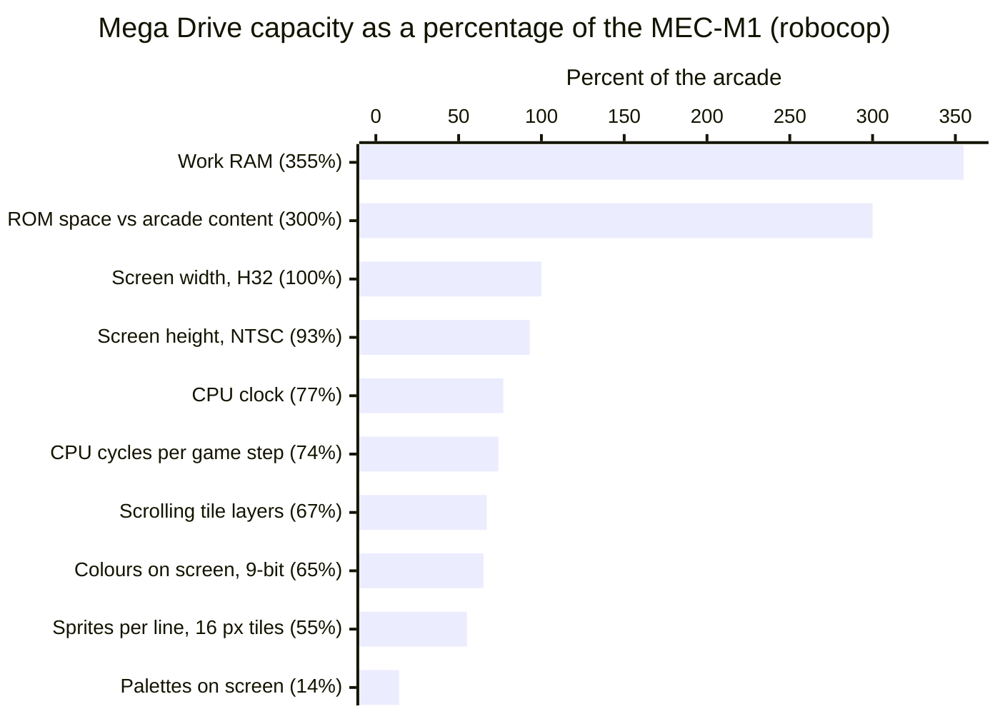

| Resource | MEC-M1 (`robocop`) | Mega Drive | Ratio |
|---|---|---|---|
| Work RAM | 18 KB (16 KB + 2 KB sprite RAM) | 64 KB | 355% |
| ROM space, against arcade content | 1.34 MB of content | 4 MB | 300% |
| Screen width | 256 px | 256 px (H32) | 100% |
| Screen height | 240 lines | 224 (NTSC) | 93% |
| CPU clock | 10 MHz | 7.67 MHz | 77% |
| CPU cycles per game step (two frames) | 348,160 | 256,023 | 74% |
| Scrolling tile layers | 3 | 2 | 67% |
| Colours on screen, counted in 9-bit RGB | 94 at most in stage 1 | 61 | 65% |
| Sprite tiles per line | 29 at most in stage 1 | 16 | 55% |
| 16-colour palettes on screen | 29 at most in stage 1 | 4 | 14% |

Compared with a CPS-1 game the gaps are small. The first rows are surpluses, the CPU and layer rows are shortfalls of a quarter to a third, and even colour is within reach once the arcade's 24-bit values are cut to the console's 9 bits. The row that stands out is palettes: the arcade gives every sprite and tile its own choice of 16 colours from 64 sets, and the console has four sets for everything.

### 1.2 Block diagrams

**MEC-M1 with the *RoboCop* ROM board.** The 68000 sees its tilemaps and palette as ordinary memory, and the video chips read pixel data from ROM on their own. A second processor sits behind a dual-port RAM.

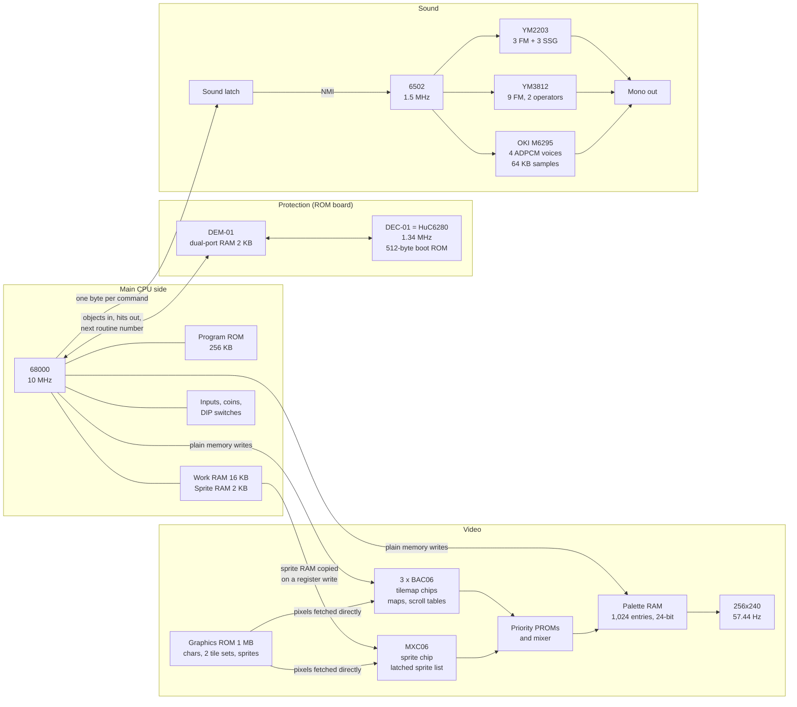

**Mega Drive.** The VDP owns its memory. The 68000 reaches it only through ports or DMA, and tile pixels must be copied into VRAM before they can be shown.

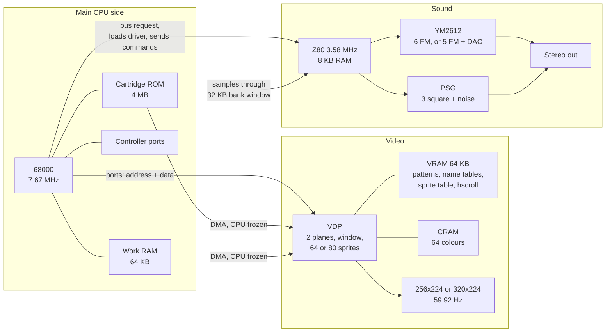

## 2. CPU and code execution

### 2.1 The same processor

Both machines use a Motorola 68000 with no MMU and no cache. Instructions, addressing modes and the exception model are identical. Machine code from the arcade ROM is valid Mega Drive code as long as it does not touch hardware addresses.

Speed is the difference:

| | MEC-M1 | Mega Drive NTSC |
|---|---|---|
| Clock | 20 MHz / 2 = 10 MHz (**MAME**, measured on a board per Guru) | 53.693175 MHz / 7 = 7.670454 MHz |
| Frame rate | 57.44 Hz (6 MHz pixel clock, 384 × 272 total; the pixel clock is unverified in MAME, which notes a board measurement of 57.41 Hz) | 59.92 Hz |
| Cycles per frame | 174,080 | 128,012 |
| Cycles per game step (two frames, see 2.4) | 348,160 | 256,023 |
| Lost to video transfers | none (video RAM is plain memory) | a full-VBlank DMA freezes the CPU for about 38 lines, about 19,000 cycles |

So the Mega Drive has about 74% of the arcade's CPU time per game step, and the hardware layer we add also has to run inside that budget.

That ratio compares capacity, not need. Measured with a profiler over six minutes of stage 1 and the start of stage 2 (**ROM**, section 2.5), the arcade 68000 spends 58% of its time in wait loops and 19% handing objects to the second processor and waiting for it. In stage 1 real work averages 78,000 cycles per game step (149,000 at the 95th percentile, 181,000 at the 99th): 30% of two Mega Drive frames on average, 71% at the 99th percentile.

### 2.2 Memory maps

| Range | MEC-M1 (`robocop`) | Mega Drive |
|---|---|---|
| `0x000000`–`0x03FFFF` | Program ROM, 256 KB (`0x03C400` and up is blank) | Cartridge ROM (`0x000000–0x3FFFFF`) |
| `0x180000`–`0x180FFF` | Dual-port RAM shared with the HuC6280, on the odd bytes | Cartridge ROM space |
| `0x240000`–`0x245FFF` | BAC06 #1 (text layer): registers, scroll tables, 6 KB of plain RAM, 8 KB tilemap | Cartridge ROM space |
| `0x246000`–`0x24A7FF` | BAC06 #2 (first 16×16 layer): registers, scroll tables, 2 KB tilemap | Cartridge ROM space |
| `0x24C000`–`0x24D7FF` | BAC06 #3 (second 16×16 layer): registers, scroll tables, 2 KB tilemap | Cartridge ROM space |
| `0x30C000`–`0x30C00B` | Sticks, buttons, coins, VBlank flag, DIP switches | Cartridge ROM space |
| `0x30C010`–`0x30C01F` | Priority, sprite latch, sound command, interrupt acknowledge | Cartridge ROM space |
| `0x310000`–`0x3107FF` | Palette, red and green | Cartridge ROM space |
| `0x314000`–`0x3147FF` | Palette, blue | Cartridge ROM space |
| `0xA00000`–`0xA0FFFF` | — | Z80 address space (YM2612 at `0xA04000`) |
| `0xA10000`–`0xA1001F` | — | Controller ports |
| `0xA11100`, `0xA11200` | — | Z80 bus request and reset |
| `0xC00000`–`0xC00011` | — | VDP data and control ports, PSG |
| `0xFF0000`–`0xFF7FFF` | — | Work RAM |
| `0xFF8000`–`0xFFBFFF` | Work RAM, 16 KB | Work RAM |
| `0xFFC000`–`0xFFC7FF` | Sprite RAM, 2 KB | Work RAM |
| `0xFFC800`–`0xFFFFFF` | — | Work RAM |

Three things line up well:

- **The game's RAM is inside the console's RAM, at the same addresses.** Every work RAM and sprite RAM reference in the game is already correct, and the initial stack pointer (`0xFFC000`) is valid.
- **The console has 46 KB of RAM the game never addresses**: `0xFF0000–0xFF7FFF` and `0xFFC800–0xFFFFFF`. The arcade's memory-mapped video tables total about 31 KB (section 2.6), so the port can keep complete copies of them and still have room for its own state. On CPS-1 this was the tightest resource; here it is free.
- **The program sits at address 0 on both.** The Mega Drive needs its header at `0x100–0x1FF`, which is where the arcade's reset code is (`0x100–0x22B`). That code only initialises hardware and talks to the second processor, so it is replaced anyway.

One thing lines up badly: **every arcade hardware address is inside the Mega Drive's cartridge space** (`0x000000–0x3FFFFF`). A write there does nothing on a plain cartridge and a read returns ROM contents. None of the arcade's hardware accesses can be left as they are; each has to be redirected.

### 2.3 Boot and interrupts

| | MEC-M1 (`robocop`) | Mega Drive |
|---|---|---|
| Reset | Vector 0: SSP `0xFFC000`, PC `0x000122` (**ROM**) | Vector 0 SSP, vector 1 PC; then TMSS write (`'SEGA'` to `0xA14000`), Z80 and VDP initialisation |
| VBlank | Level 6 autovector → `0x001002` (**ROM**); acknowledged by a write to `0x30C018` | Level 6 autovector |
| Other IRQs | Level 4 from the dual-port RAM when the HuC6280 writes its last byte (**MAME**); the game never uses it (**ROM**) | Level 4 HBlank (programmable line counter), level 2 external |
| Unused vectors | All 61 others point at `0x100`, which resets the game (**ROM**) | — |

The game uses exactly one hardware interrupt, and it is on the same level as the Mega Drive's VBlank. The handler keeps its vector. The main program runs with the interrupt mask at 5 (`move #$2500,sr`), which lets level 6 through and shuts out level 4; on the Mega Drive it has the same effect on VBlank and HBlank.

The level 4 interrupt is the one from the dual-port RAM. The 68000 clears its flag by reading `0x180FFC` at start-up and never enables it.

### 2.4 How the game program runs (measured from the ROM)

**Reset (`0x100`, `0x122`).** Tells the HuC6280 to restart and waits for it, sets the control registers, clears work RAM (`0xFF8000–0xFFBFFF`), sets up the video chips, lowers the interrupt mask to 5, uploads the HuC6280's program, then falls into the attract loop and the main loop.

**Plain absolute addressing.** There is no global base register. Every variable is addressed by its full address (`move.b $ffb21d.l,d0`), and so is every hardware register. Calls are `jsr d16(pc)` followed by a `nop`, or `jsr abs.l`: the shape of code from a macro assembler and a linker that leaves room for a long call. Jump tables are tables of 32-bit pointers.

This matters for the port: **a hardware address in this program is almost always a 32-bit constant inside an instruction**, so it can be found by scanning and changed in place without moving any code. The program holds 195 values in the dual-port RAM's range, 297 in the text tilemap's, 116 in the plain RAM at `0x242800`, 27 in the other two tilemaps', 39 in the input and control registers' and 37 in the palette's (byte-pattern counts, so they include a few plain numbers that only look like addresses).

**One loop, no kernel.** The game is a single main loop with a frame wait at the top:

- `0x17BA` waits until the VBlank handler has counted one frame; `0x17E8` waits for two. Both spin on a counter at `0xFF8004` that the VBlank handler increments.
- Gameplay calls the two-frame wait. **The game logic runs once every two frames: 28.7 steps a second.** Sprite RAM is latched once per step and the HuC6280 is interrupted once per step (**ROM**, trace: the sprite latch is written in 51% of gameplay frames).
- After the wait, the main loop asks the HuC6280 which routine to run next, runs it, and asks again, until the HuC6280 answers "done" (section 2.7).

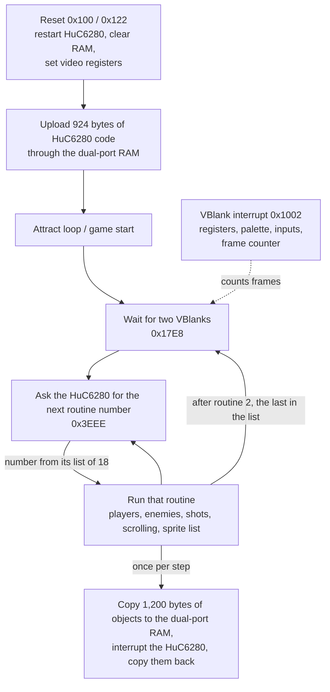

**The VBlank handler (`0x1002`).** Once per frame it:

1. Writes the sprite latch (`0x30C012`), if the main loop has a finished sprite list: the hardware copies sprite RAM into the sprite chip's buffer.
2. Copies each tilemap chip's control and scroll registers from shadow copies in work RAM, and the column and row scroll tables, but only for chips whose "changed" flag is set.
3. Applies queued palette changes: whole 256-entry blocks copied from ROM tables, and a second path that looks like fades (not read in detail).
4. Reads the coin inputs, counts credits and sends the coin sound.
5. Increments the frame counter.
6. Spins until the VBlank flag at `0x30C003` goes low, then acknowledges the interrupt and returns.

Step 6 is a wait loop inside the interrupt handler. It exists to keep the handler from being entered twice in one VBlank; on the Mega Drive it has to go.

Most hardware registers are written in this handler from shadows in work RAM. That makes it the natural seam for a replacement, as on CPS-1.

One arcade game step, in order:

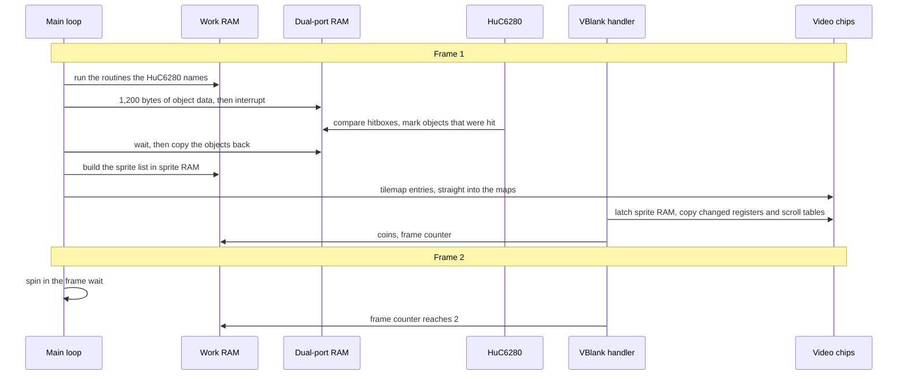

**How tightly the code is tied to the hardware.** Counted on the running game (**ROM**, write and read taps on every hardware range over 21,600 frames: attract mode, stage 1 with its boss, and the start of stage 2):

| Hardware | Instructions that touch it | Reads | Writes |
|---|---|---|---|
| Dual-port RAM | 37 | 22.5 million | 11.5 million |
| Text tilemap (BAC06 #1) | 84 | 149,000 | 579,000 |
| Plain RAM at `0x242800` | 33 | 88,000 | 11,000 |
| Text layer scroll tables | 2 | — | 249,000 |
| First 16×16 tilemap (BAC06 #2) | 3 | — | 23,000 |
| Second 16×16 tilemap (BAC06 #3) | 13 | — | 34,000 |
| Tilemap chip registers (all three) | 28 | — | 19,000 |
| Palette (both halves) | 14 | — | 88,000 |
| Inputs and DIP switches | 14 | 4.3 million | — |
| Control registers | 17 | 4 | 34,000 |
| Sprite RAM | 4 | — | 1.2 million |

About **250 instructions** in the whole program touched hardware in that run. The static scan finds more addresses than that (text printing has many call sites with a fixed screen position each), and later stages will add some, but the scale is hundreds, not the thousands of a CPS-1 game. Three points stand out:

- The game **reads the text tilemap back**, and uses 6 KB of the first tilemap chip's address space as ordinary RAM. Those areas need real memory behind them, not just a write hook.
- The two scrolling layers are written by 16 instructions between them. The level drawing code is tiny.
- The dual-port RAM takes more traffic than everything else together: 1,200 bytes out and 1,200 back per game step.

### 2.5 Where the arcade's CPU time goes

Sampling profile, 12,000 samples a second, frames 300 to 21,600 of the same run (**ROM**):

| Where | Share of all samples | Cycles per game step |
|---|---|---|
| Frame wait loops (`0x17BA`, `0x17E8`) | 53.1% | 185,000 |
| The VBlank handler waiting for VBlank to end (`0x1156`) | 5.3% | 18,000 |
| Copying object records to and from the dual-port RAM (`0x7620`, `0x7680`) | 15.6% | 54,000 |
| Waiting for the HuC6280 to answer | 3.7% | 13,000 |
| The rest of the VBlank handler | 0.8% | 3,000 |
| Everything else: the game | 21.5% | 75,000 |

Those are averages over the whole run, attract mode included. For gameplay alone, per game step:

| | Stage 1 (2,550 steps) | Start of stage 2 (1,200 steps) |
|---|---|---|
| Real work, mean | 77,900 | 91,300 |
| Real work, 95th / 99th percentile | 149,100 / 180,700 | 151,100 / 178,200 |
| Serving the HuC6280, mean | 73,300 | 76,800 |
| Steps whose real work is more than one Mega Drive frame (128,012) | 10.9% | 10.3% |
| Steps whose real work is more than two Mega Drive frames (256,023) | 0.12% | none |

The sampler takes about 420 samples per step, so single steps are uncertain by several thousand cycles; the means and percentiles are over thousands of steps.

The arcade board has headroom the game does not use: the 68000 idles for more than half of every game step, and a fifth of its time is the price of the protection, not game logic. What has to fit on the Mega Drive is the last row, plus the hit detection the HuC6280 did, plus our video layer.

### 2.6 What the port has to hold in RAM

The arcade's memory-mapped tables, which the port needs copies of because the game either reads them back or the video layer has to translate them:

| Table | Size |
|---|---|
| Dual-port RAM (2,048 bytes, one per word on the 68000 side) | 4 KB as the game addresses it, 2 KB packed |
| Text tilemap | 8 KB |
| Plain RAM at `0x242800` | 6 KB |
| Two 16×16 tilemaps | 4 KB |
| Column and row scroll tables, three chips | 3.4 KB |
| Palette, two halves | 4 KB |
| **Total** | **about 29–31 KB** |

Against 46 KB free. In the run above the game wrote 6,534 of its own 16,384 work RAM bytes after start-up, so there is further slack inside `0xFF8000–0xFFBFFF`, but nothing there should be claimed before every stage has been traced.

### 2.7 The second processor

The *RoboCop* ROM board carries a chip marked DEC-01, which is a HuC6280 (the PC Engine's CPU), and a chip marked DEM-01, which is a Fujitsu MB8421 dual-port RAM of 2 KB (**MAME**). The HuC6280 has a 512-byte ROM and 8 KB of RAM. It has no access to anything but the dual-port RAM.

What it does (**ROM**: disassembly of its boot ROM and of the code the 68000 sends it, with MAME's debugger):

1. **Boot ROM.** Waits for the 68000, copies 1,008 bytes from the dual-port RAM into its own RAM at `0x2202`, checks the first bytes and jumps there. Its interrupt handler calls into that code.
2. **The uploaded program** is 924 bytes, stored in the 68000 program ROM at `0xD772` and sent at every reset. So the complete HuC6280 program is in the set we have, in the clear.
3. **Main loop sequencing.** The uploaded program holds a table of 18 numbers: `06 03 0F 1B 09 1A 07 0D 08 10 19 17 13 18 05 14 01 02`. Each time the 68000 asks (`0x3EEE`), it hands out the next one, and the 68000 uses it as an index into a table of routines at `0x3F38`. The last number, 2, also tells the 68000 the step is complete. The order in which the game's subsystems run each step is therefore decided on the HuC6280, and the 68000 program does not contain it.
4. **Hit detection.** Once per step the 68000 copies a count and 1,200 bytes of object records (30 records of 40 bytes, from `0xFF983A`) and a few player variables into the dual-port RAM and raises the HuC6280's interrupt by writing `0x180FFE`. The handler walks the records, adds each one's position to box sizes from tables in its own program, compares the boxes, and marks records that were hit (it sets a state byte to 4, or a flag bit for object type 6). The 68000 waits for a flag to clear and copies all 1,200 bytes back. This is our reading of the listing; it has not been checked instruction by instruction yet.

A board without the HuC6280, or with the wrong program in it, hangs at start-up: every exchange is a busy wait on a byte the HuC6280 must change. MAME lists a bootleg (`robocopb`) that runs on a board with no HuC6280, so the dependency has been removed from this program before.

For the port this is good news in three ways. The whole protection is 924 bytes of readable 6502-family code with no secret inside the chip. Its two jobs are simple: the sequence is a fixed list, and the hit detection is box comparisons that the 68000 can do directly on the object records in work RAM, without the two 1,200-byte copies. And the time the arcade 68000 loses to it comes back.

### 2.8 Inputs and control registers

| Address | Arcade | Notes for the port |
|---|---|---|
| `0x30C000` | Player 1 and 2: up, down, left, right, attack, jump, active low | Build the same word from the pads |
| `0x30C002` | Start 1, start 2, coin 1, coin 2, service, and bit 7 = VBlank flag | The game reads coins in the VBlank handler and spins on bit 7 |
| `0x30C004` | Two DIP switch banks: coinage, demo sounds, flip screen, cabinet, energy, difficulty, continue, bonus stage energy, brink time | Fixed defaults or an options screen; the game reads them during play (`0x7690`), so they must stay readable |
| `0x30C010` | Priority register | 0 in gameplay, 6 on the title screen |
| `0x30C012` | Sprite latch: copies sprite RAM to the sprite chip | The moment to translate the sprite list |
| `0x30C014` | Sound command (low byte) | One routine sends them (`0x19C6`), plus four fixed commands in the coin handler |
| `0x30C018` | VBlank interrupt acknowledge | Not needed |

## 3. Rendering on the MEC-M1

### 3.1 Model

The video system has no pattern memory. The game writes *lists* (which tile goes where), and the video chips fetch pixel data directly from the graphics ROMs while drawing. Any tile in the ROMs can be on screen at any time at no cost.

- Pixel clock 6 MHz, 384 × 272 total, 256 × 240 visible (lines 8 to 247), 57.44 Hz (**MAME**; the pixel clock is marked unverified there).
- Three BAC06 chips, one per tile layer, each with its own tilemap RAM, control and scroll registers and scroll tables. One MXC06 for sprites. Priority between them is decided outside the chips, by PROMs.

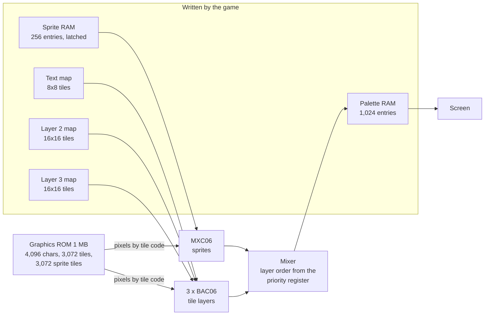

### 3.2 Tile layers

| Layer | Chip | Tile size | Map in this game | Graphics | Palettes | Used for |
|---|---|---|---|---|---|---|
| Text | BAC06 #1, `0x244000` | 8×8 | 64×64 cells, 512×512 px | 4,096 characters | 16, entries 0–255 | Score, timer, energy bar, messages, title screen |
| Layer 2 | BAC06 #2, `0x24A000` | 16×16 | 32×32 tiles, 512×512 px | 2,048 tiles (`tiles1`) | 16, entries 512–767 | The street and buildings: the playfield |
| Layer 3 | BAC06 #3, `0x24D000` | 16×16 | 32×32 tiles, 512×512 px | 1,024 tiles (`tiles2`) | 16, entries 768–1023 | The skyline behind; empty in stage 2's interior |

- A map entry is one word: 4-bit palette, 12-bit tile code. **There are no flip bits and no per-tile priority bit.**
- Each chip has a control register that picks 8×8 or 16×16 tiles and the map's shape (4×1, 2×2 or 1×4 screens), and enables row scroll and column scroll. *RoboCop* sets all three layers to 2×2 screens and row-major order in every frame we traced (**ROM**).
- Row scroll (a horizontal offset per group of lines) and column scroll (a vertical offset per group of columns) come from tables in the chip. In stage 1 and the start of stage 2 only the text layer ever has row scroll enabled, in 3% of gameplay frames; the two scrolling layers never do. The game's VBlank handler copies the text layer's tables every time they change and never wrote the other two layers' tables.
- A 512×512 map is small: stages are wider than that, so the game draws new columns into the map as the screen scrolls, 16 instructions' worth of code (section 2.4).

Layer order comes from the priority register at `0x30C010` (**MAME**, which says its reading for this game "might be just completely wrong" because the game uses it so little):

| Bit | Meaning |
|---|---|
| 0 | Swap layers 2 and 3 |
| 1 | Some sprites go behind the front tile layer |
| 2 | Which sprites: those with palette 8–15, or those with palette 0–7 |

With the register at 0, as in all gameplay we traced, the order back to front is: layer 3 (opaque), layer 2, sprites, text. The title screen sets it to 6.

### 3.3 Sprites

- Sprite RAM holds 256 entries of four words: Y and flags, tile code, X and palette, one unused. The game writes it during the step; a write to `0x30C012` copies it to the sprite chip, so the list on screen is always a complete one.
- Flags in each entry: visible, flip X, flip Y, width and height of 1, 2, 4 or 8 tiles, and "flash" (drawn every other frame).
- A tall sprite takes one entry and consecutive tile codes; a wide one takes one entry per column. So a block of up to 8×8 tiles of 16×16 pixels costs at most 8 entries.
- 4-bit palette per sprite (16 palettes, entries 256–511). Pen 0 is transparent.
- MAME draws the list with no per-line limit, later entries over earlier ones. Whether the real chip has a limit is an [open question](#open-questions).

### 3.4 Colour

- 1,024 entries: four blocks of 256, one per graphics type (text, sprites, layer 2, layer 3), each 16 palettes of 16 colours.
- Each entry is 24 bits, split over two RAMs: red and green at `0x310000`, blue at `0x314000`.
- **The game uses only 16 levels per channel** (**ROM**: in the stage 1 palette, each of red, green and blue takes 16 distinct values). The arcade picture is 4,096-colour art in a 16.7-million-colour register.
- Palette changes are made in the VBlank handler, mostly as whole-block copies from ROM tables.

### 3.5 Graphics ROM

All graphics are 4 bits per pixel, stored as four separate bit planes (**ROM**):

| Region | Size | Slots | Blank or unprogrammed | Distinct | As 8×8 patterns: non-blank / distinct |
|---|---|---|---|---|---|
| Characters, 8×8 | 128 KB | 4,096 | 376 blank | 1,096 | 3,720 / 1,096 |
| Tiles 1, 16×16 (layer 2) | 256 KB | 2,048 | 741 | 1,300 | 4,984 / 3,976 |
| Tiles 2, 16×16 (layer 3) | 128 KB | 1,024 | 486 | 473 | 2,115 / 1,699 |
| Sprites, 16×16 | 384 KB in a 512 KB space | 3,072 | 699 | 2,281 | 7,206 / 6,492 |

Stored as Mega Drive patterns with duplicates removed, all of it is about 13,300 patterns, 425 KB.

## 4. Rendering on the Mega Drive

### 4.1 Model

The VDP draws from its own 64 KB of VRAM, which holds *both* the tile pixels and the tables. The 68000 cannot address VRAM; it sends an address and data through ports at `0xC00000`, or asks the VDP to pull a block from ROM/RAM by DMA. Rendering is line by line with fixed per-line limits.

Two picture widths, chosen by a register:

| | H32 | H40 |
|---|---|---|
| Picture | 256×224 | 320×224 |
| Sprites per frame | 64 | 80 |
| Sprites per line | 16 | 20 |
| Sprite pixels per line | 256 | 320 |
| Sprite table | 512 bytes | 640 bytes |

Both run at 59.92 Hz on NTSC with 262 lines. PAL consoles run at 49.70 Hz with 313 lines and can show 240 lines (V30), which with H32 is exactly the arcade's 256×240.

- Pattern: 8×8 pixels, 4 bpp, 32 bytes, pixels packed two to a byte (the arcade stores four separate planes: every tile has to be converted).

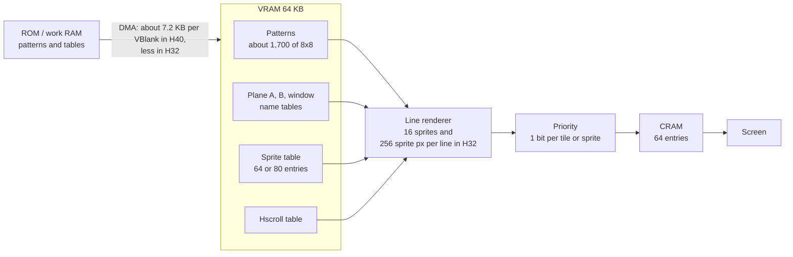

### 4.2 VRAM budget

For H32 with two 64×32 planes (512×256 px each):

| Item | Bytes |
|---|---|
| Plane A name table (64×32) | 4,096 |
| Plane B name table (64×32) | 4,096 |
| Window name table (32×32 in H32), if used | 2,048 |
| Sprite attribute table | 512 |
| Horizontal scroll table (per-line) | 896 |
| **Left for patterns** | **about 53.9 KB ≈ 1,680 patterns** |

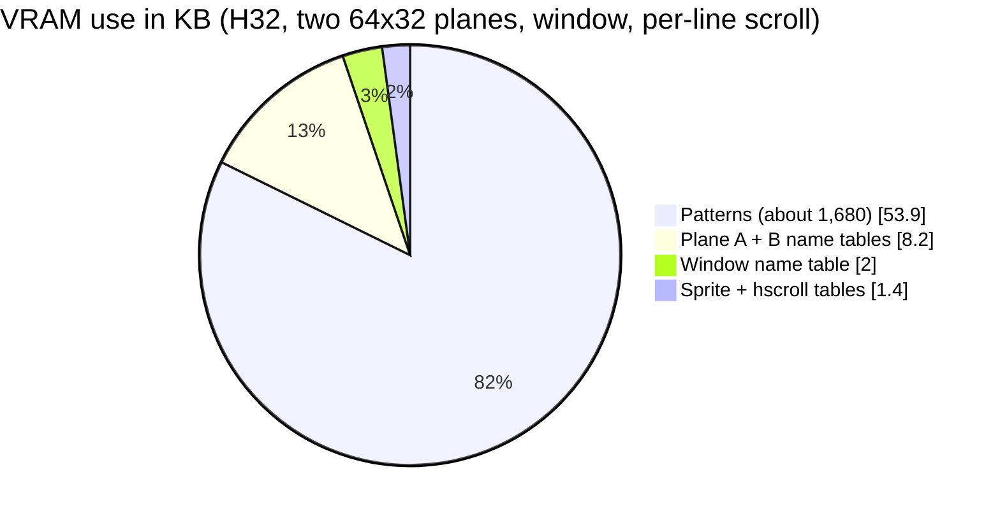

For scale: in stage 1 the arcade shows 645 distinct non-blank 8×8 patterns on an average frame and 794 at most, sprites and all three layers together (**ROM**). **A whole arcade frame fits in VRAM twice over.** On CPS-1 one screen of the far background alone could fill it.

### 4.3 Planes

- Two scrolling planes, A and B, of the same size (32, 64 or 128 cells each way, up to 64×64 or 128×32).
- Name table entry: priority bit, 2-bit palette, flip V, flip H, 11-bit pattern index. Stored row by row, as the arcade's maps are in this game.
- Horizontal scroll: whole plane, per 8-pixel row, or per scanline. Vertical scroll: whole plane or per 16-pixel column.
- The window replaces plane A in a region anchored to the screen edges and does not scroll.
- Priority order, back to front: backdrop, B low, A low, sprites low, B high, A high, sprites high. Priority is one bit per *tile* or per sprite.

A 64×32 plane is 512×256 pixels: the arcade's map width, half its height. Horizontal scrolling can use the plane exactly as the arcade uses its map; vertical scrolling beyond 256 lines needs rows redrawn as they come into view, or a 64×64 plane at the cost of 4 KB of VRAM each.

### 4.4 Sprites

- 64 sprites per frame in H32 (80 in H40), each 1–4 cells wide and high (up to 32×32 px), chained by a link field that also sets draw order.
- Per scanline in H32: 16 sprites and 256 sprite pixels. Excess sprites are dropped on that line, last in link order first.
- Sprite patterns come from the same VRAM as plane patterns, and are stored column by column inside a sprite.

A Mega Drive sprite of 32×32 pixels covers four arcade sprite tiles, and the arcade's own blocks (1, 2, 4 or 8 tiles each way, consecutive tile codes down a column) cut cleanly into such pieces.

### 4.5 Colour

- 64 CRAM entries: 4 palettes of 16, 3 bits per channel (512 colours). Colour 0 of each palette is transparent, so 61 are usable.
- Planes and sprites share the same 4 palettes.
- Shadow/highlight mode can add darker and brighter variants, with restrictive rules.
- Palettes can be changed mid-frame from an HBlank interrupt (for example a different palette set for a HUD band), at the cost of some CPU time and possible stray dots.

### 4.6 The transfer budget

This is the constraint with no arcade counterpart.

| | Bytes to VRAM (NTSC, H40) |
|---|---|
| Per scanline, display active | 18 |
| Per scanline, blanking | about 200 (sources give 198–205) |
| DMA during VBlank, per frame | about 7,200 (SGDK's figure) |

- H32 is slower per line than H40; we have not pinned the figure down ([open questions](#open-questions)).
- The sprite table and any name table or scroll updates come out of the same budget.
- The 68000 is frozen while a ROM/RAM-to-VRAM DMA runs.
- DMA source data must not cross a 128 KB boundary.

Against that: the arcade brings 6 new patterns into view per frame on average in stage 1, 32 at the 95th percentile and 129 at most (about 4 KB) (**ROM**). And the game only changes what is on screen every second frame, so there are two VBlanks per step to deliver it.

## 5. The rendering gap

| Arcade behaviour | Mega Drive reality | Direction |
|---|---|---|
| Game writes tile codes; hardware reads ROM | Patterns must be in VRAM first | Pattern cache keyed by arcade tile code and palette; a frame's worth fits in VRAM, so eviction is rare |
| Game writes tilemaps and palette as memory, and reads some back | VRAM only through ports | Redirect the addresses to copies in the 46 KB of spare RAM, and translate what changed each step |
| 256×240 | 256×224 on NTSC | Lose 8 lines top and bottom, or scroll the view to follow the player; the text layer's top and bottom rows need moving in. PAL can show all 240 |
| Three tile layers | Two planes + window | Layer 3 → plane B, layer 2 → plane A, text → window, sprites or high-priority cells |
| 16×16 tiles, one word per tile, no flips | 8×8 cells | Each arcade tile becomes 4 cells; both are row-major |
| 4-plane tile data | Packed 4 bpp patterns | Convert at build time |
| Sprites in front of or behind a layer by palette number and a register | One priority bit per tile and per sprite | Set the sprite's priority bit from the same rule |
| Sprite blocks up to 128×128 px from 16×16 tiles, 256 entries | 32×32 px, 64 per frame, 16 per line | Cut blocks into 32×32 pieces, skip blank cells, rotate order on overflow so dropout becomes flicker |
| Last sprite entry is on top (as MAME draws it) | First in link order is on top | Build the link chain in reverse |
| "Flash" bit: sprite drawn every other frame | No such bit | Drop the sprite on alternate frames in the translation |
| 64 palettes of 16, 16 levels per channel | 4 palettes of 16, 8 levels per channel | Per-scene palette plans; sprites and tiles that differ only by palette share remapped pixel data |
| Palette fades by rewriting palette RAM | Same idea, 64 entries | Fades must be applied to the reduced palette, not the arcade one |
| Row and column scroll tables | Per-line hscroll, per-column vscroll | Direct equivalent where used; so far only the text layer uses row scroll |
| Sprite list latched on a register write | VBlank upload | The latch write is the signal that a list is complete |
| 57.44 frames a second, a step every two | 59.92 | Run a step every two frames: 4% faster than the arcade |

Layer order, back to front, and the likely mapping:

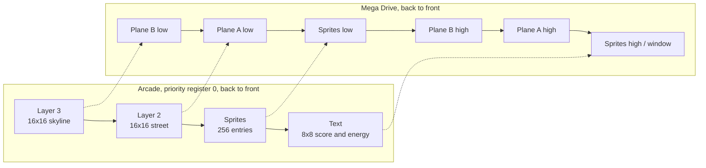

What stage 1 asks of each Mega Drive limit (**ROM**, 5,006 gameplay frames; details in [doc 03](03-robocop-measured.md)):

| | Arcade, stage 1 | H32 limit | H40 limit |
|---|---|---|---|
| Sprite tiles on screen (16×16) | 44 mean, 102 max | — | — |
| The same, cut into pieces of up to 32×32 | 29 mean, 64 max | 64 | 80 |
| Sprite tiles on one line | 10.5 mean, 29 max; over 16 in 11% of frames, over 20 in 4% | 16 | 20 |
| Text cells with something in them | 71 mean, 92 max | window, or about 25 more sprites | |
| Distinct patterns on screen | 592 mean, 794 max | about 1,680 | about 1,610 |
| Palettes of 16 in use | 23 mean, 29 max | 4 | 4 |
| Distinct colours, 24-bit / as 9-bit | 140 / 72 mean, 174 / 94 max | 61 | 61 |

Two results decide the shape of the video layer. **Patterns are not the problem**: everything visible fits in VRAM with half of it to spare. **Sprites per line and palettes are**: one line in nine has more sprite tiles than H32 can show, the sprite count is at the H32 limit before the text layer is added, and 23 palettes have to become 4.

The colour reduction is still the part with the most visible cost. Arcade tiles are stored as 4-bit indexes into whichever palette the game assigns at run time, so the same tile can appear in different palettes. Converting to 4 shared palettes means deciding, per scene, which arcade palettes merge, and remapping tile pixels to match. It is easier here than on CPS-1 in one respect: once cut to 9 bits a stage 1 frame has about 72 distinct colours, so the target of 61 is close.

## 6. Sound

| | MEC-M1 (`robocop`) | Mega Drive |
|---|---|---|
| Sound CPU | 6502 at 1.5 MHz, 2 KB RAM, 32 KB program, not encrypted | Z80 at 3.58 MHz, 8 KB RAM, program loaded by the 68000 |
| Tick | YM3812 timer interrupt, about 840 a second (**ROM**: timer reloads counted over 7,200 frames) | One interrupt per frame; YM2612 timers |
| FM | YM2203 (OPN): 3 channels of 4 operators. YM3812 (OPL2): 9 channels of 2 operators, 4 waveforms | YM2612 (OPN2): 6 channels of 4 operators, sine only, stereo panning |
| Square waves | YM2203's SSG: 3 channels + noise | PSG: 3 square + noise |
| Samples | OKI M6295: 4 voices of 4-bit ADPCM at 7,575 Hz; 17 samples, 62 KB, 16.5 seconds in all (**ROM**) | YM2612 channel 6 as an 8-bit DAC, mixed in software by the Z80 |
| 68000 → sound | One byte to a latch at `0x30C015`; the latch raises the 6502's NMI | Z80 RAM at `0xA00000` after a bus request |
| Output | Mono | Stereo |

What the game uses (**ROM**, 7,200 frames from power-on through stage 1):

- All nine YM3812 channels are keyed, 160 to 460 times each: the music is mostly there.
- All three YM2203 FM channels and two of its square-wave channels are used.
- All four OKI voices are used, 15 of the 17 samples in this run.
- The 68000 sent 57 different command values.

Consequences:

- The YM2203 is the YM2612's close relative: its three FM channels carry over almost register for register (the YM2612 adds panning and LFO, and its clock is different, so frequencies need rescaling).
- The YM3812 has no equivalent. Nine 2-operator voices with OPL waveforms have to be arranged onto what is left of six 4-operator sine voices. A 2-operator patch can be written as a 4-operator patch with two operators silent, so the timbres are approximable; the voice count is the constraint: 12 FM voices into 6, or 5 with the DAC in use.
- Square-wave parts move to the PSG nearly directly.
- The samples are small. Decoded to 8-bit PCM at the arcade's rate they are about 125 KB, and a Z80 PCM driver can mix two to four of them (XGM2: 3 channels at 13.3 kHz; MDSDRV: 2 at 17.5 kHz or 3 at 13.3 kHz).
- The command interface is narrow: one byte per command. Replacing the routine at `0x19C6` and the four fixed writes in the coin handler redirects all sound.
- The 6502 program is plain code and data in the set (`ep03-3`), so the sequence data can be read out. The driver itself is useless on the Mega Drive.
- The *RoboCop MD* demo already has the arcade music arranged for the YM2612 by its composer ([doc 02](02-robocop-arcade-vs-md-demo.md)). That is their work, not ours to take; it shows the arrangement is possible and how it can sound.

## 7. Storage, input and saving

**ROM size.** Arcade content is 256 KB program + 896 KB graphics + 64 KB samples + 32 KB sound program: 1.22 MB, or 1.34 MB counting the empty quarter of the sprite space. Converted (patterns deduplicated, samples decoded) it is about the same. A flat 4 MB cartridge holds it three times over, so there is no mapper, no banking, and room to store graphics more than once (for example remapped to different palettes). For comparison, the *RoboCop MD* demo is 1.13 MB with one stage.

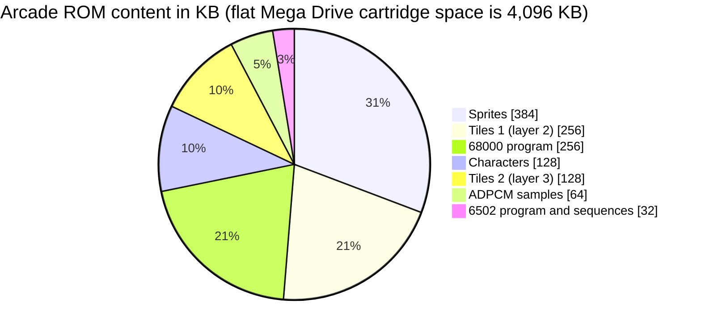

The 256 KB program stays at its original addresses at the bottom of the cartridge; graphics, sound and the new hardware layer follow it.

**Input.** Two players with a stick and two buttons each, read active-low from one word at `0x30C000`, with coins and start buttons in the next. The Mega Drive pad protocol is different (TH line toggling, two reads per pad) but the result is the same kind of word. Coin and start need a mapping (for example Start as coin and start together).

**Settings.** DIP switches, read at `0x30C004` at start-up and during play. A fixed word of defaults is enough to begin with; an options screen can replace it.

## 8. What this means for the port

Two strategies exist; prior art has both.

**A. Rewrite.** New game written for the Mega Drive (typically C with SGDK), using the arcade only as reference. *RoboCop MD* by Boca's Retro Stuff is a rewrite: its page says it contains no reverse-engineered code. Gameplay accuracy depends on how well behaviour is re-created.

**B. Keep the arcade 68000 code, replace the hardware.** The original program runs on the Mega Drive's 68000 with its hardware addresses redirected, plus a new layer that turns the arcade's video tables into VDP work each step. Precedents:

- JOTD's *Bad Dudes* for Amiga: the original 68000 code of another MEC-M1 game, with a patch list from a disassembly plus MAME traces. The closest precedent there is: the same board, the same video chips.
- [Cadillacs and Dinosaurs MD](https://github.com/Evilu/cadillacs-and-dinosaurs-md): a CPS-1 program running on the Mega Drive over a replaced hardware layer. Stage 1 plays; this project reuses its method and tools.
- *Shinobi* (System 16) and *Alien Syndrome* on Mega Drive: arcade code kept, hardware layer replaced, graphics pre-converted offline.

The shape of strategy B for this game:

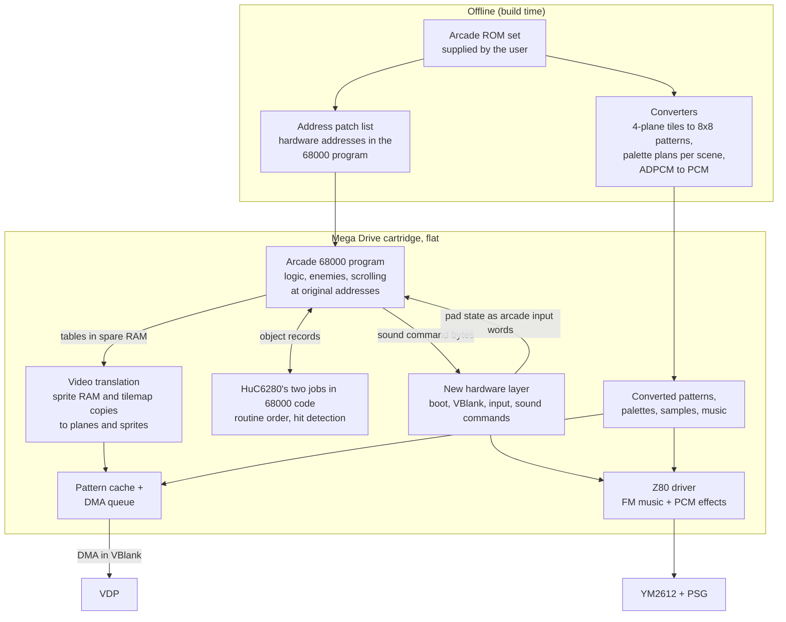

Why B looks feasible for `robocop` specifically:

- Same CPU; the game's RAM is a subset of the console's, at the same addresses; program at address 0.
- One interrupt, on the level the Mega Drive already uses for VBlank.
- Hardware addresses are 32-bit constants in the code: they can be redirected by changing the constant, without traps or moved code. About 250 instructions touched hardware in six minutes of play.
- The spare 46 KB of console RAM holds a full copy of every arcade video table.
- The CPU has slack: real work is about 30% of the Mega Drive's time per game step on average and 71% at the 99th percentile, before our layer and the hit detection.
- Everything fits in a flat 4 MB cartridge. A scene's patterns fit in VRAM.
- Sound and input each pass through one routine.
- The protection is fully visible: its program is in the 68000 ROM.

What makes it hard:

1. **The HuC6280's work.** 924 bytes of 6502-family code to understand exactly and rewrite: an error in hit detection changes gameplay in ways that are hard to see. It can be checked against the original by running both on the same object records.
2. **Colour.** About 25 palettes into 4, in every scene, with fades.
3. **Sprites per line.** Crowded moments exceed 16 sprites and 256 pixels per line in H32. H40 has higher limits but shows the 256-pixel picture with borders or stretched art; the choice has to be made early because it sets the sprite and VRAM budgets.
4. **The text layer.** Up to 92 cells over a scrolling playfield, at the top and the bottom of the screen, with only one window region available and the sprite count already at the limit.
5. **Screen height.** 16 lines fewer on NTSC, in a game whose HUD uses the top and bottom rows.
6. **Music.** Twelve FM voices on two different chips into six.
7. **Later stages.** Everything measured so far is attract mode, stage 1 and the first screens of stage 2. The game has more stages, bonus rounds (a shooting gallery with its own view), and an ending; any of them may use row scroll, the priority register or the map shapes differently.

A phased plan built on strategy B is in [doc 04](04-port-plan.md).

## 9. Next phase: comparing with the demo

| ROM | Role |
|---|---|
| *RoboCop* (World, revision 4), MEC-M1 (`robocop`) | The game to port |
| *RoboCop MD* v0.1.0 demo 1 (Boca's Retro Stuff, fan port) | The reference for how this game is made to work on Mega Drive hardware |

The demo's author states it was written from scratch with SGDK and contains no arcade code, so its code will not correspond to the arcade's routine by routine. The comparison is about data and behaviour (picture width, VRAM layout, palettes, sprite counts, DMA volume per frame), observed in an emulator's VDP trace: [doc 02](02-robocop-arcade-vs-md-demo.md).

## Open questions

Hardware facts not settled by the sources we read:

- The pixel clock and exact frame rate of a real board: MAME uses 6 MHz and 57.44 Hz and marks the clock unverified; its notes give a measured 57.41 Hz.
- Whether the MXC06 has a per-line or per-frame sprite limit. MAME draws everything.
- The exact meaning of the priority register for this game (MAME's own comment doubts its reading).
- The HuC6280's real speed relative to the 68000 matters only if the game depends on how long hit detection takes; we have not seen that it does.
- Mega Drive DMA rate in H32, per blanking line and per VBlank.
- VDP sprite table caching behaviour and sprite masking rules (recalled, not re-read).
- Whether the `robocopb` bootleg's program shows a simpler way to remove the HuC6280 than rewriting its two jobs. We do not have that set.

Things to measure on `robocop` itself:

- Every stage after the first: sprites, patterns, palettes, layer registers, row scroll use, CPU work. All figures here are attract mode, stage 1 and the start of stage 2.
- How much of the 16 KB work RAM the whole game uses.
- The bonus rounds and the ending, which the MAME driver notes have had emulation fixes.
- How many 68000 cycles the hit detection costs when written for the 68000.
- Whether any code or data in `0x100–0x1FF`, where the Mega Drive header goes, is used after start-up.
- The complete list of sound commands and which are music.

## Sources

MEC-M1 / `dec0`

- MAME: [`dec0.cpp`](https://github.com/mamedev/mame/blob/master/src/mame/dataeast/dec0.cpp) (memory maps, clocks, board layouts by Guru), [`dec0_v.cpp`](https://github.com/mamedev/mame/blob/master/src/mame/dataeast/dec0_v.cpp), [`dec0_m.cpp`](https://github.com/mamedev/mame/blob/master/src/mame/dataeast/dec0_m.cpp), [`decbac06.cpp`](https://github.com/mamedev/mame/blob/master/src/mame/dataeast/decbac06.cpp), [`decmxc06.cpp`](https://github.com/mamedev/mame/blob/master/src/mame/dataeast/decmxc06.cpp); read at the 0.289 tag, the version that ran our traces

Mega Drive

- Charles MacDonald, [gen-hw.txt](https://gendev.spritesmind.net/mirrors/cmd/gen-hw.txt)
- [md.railgun.works VDP](https://md.railgun.works/index.php?title=VDP)
- plutiedev: [DMA](https://plutiedev.com/dma-transfer), [sprites](https://plutiedev.com/sprites), [controllers](https://plutiedev.com/controllers), [ROM header](https://plutiedev.com/rom-header), [YM2612](https://plutiedev.com/ym2612-registers)
- Raster Scroll: [VDP overview](https://rasterscroll.com/mdgraphics/vdp-overview/), [inner workings](https://rasterscroll.com/mdgraphics/vdp-inner-workings/)
- SGDK: [repository](https://github.com/Stephane-D/SGDK), [`dma.h`](https://raw.githubusercontent.com/Stephane-D/SGDK/master/inc/dma.h), [`xgm2.h`](https://raw.githubusercontent.com/Stephane-D/SGDK/master/inc/snd/xgm2.h)
- Sound drivers: [MDSDRV](https://github.com/superctr/MDSDRV), [Mega PCM](https://github.com/vladikcomper/MegaPCM)

Prior art

- [RoboCop MD](https://bocasretrostuff.itch.io/robocop-md) (Boca's Retro Stuff)
- JOTD, [Bad Dudes for Amiga](https://github.com/jotd666/baddudes)
- [Cadillacs and Dinosaurs MD](https://github.com/Evilu/cadillacs-and-dinosaurs-md) and its [CPS-1 vs Mega Drive document](https://github.com/Evilu/cadillacs-and-dinosaurs-md/blob/main/docs/01-architecture-cps1-vs-mega-drive.md), whose structure this one follows
- [Final Fight MD](https://mxretrodev.itch.io/final-fight-md)
