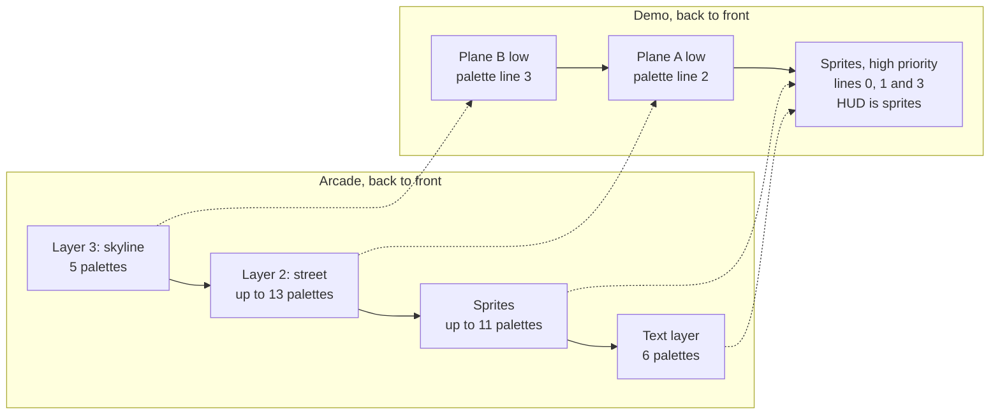

# RoboCop: arcade vs the RoboCop MD demo

What the fan-made Mega Drive version does with the same stage, measured next to the arcade. The demo is the reference for how this game can be made to look on the console: picture width, layer mapping, palettes, sprite budget. It is not a reference for code.

## Sources and method

| ROM | What it is |
|---|---|
| `robocop` (World, revision 4) | The arcade game, MAME 0.289 |
| `robocop-md-v0.1.0-demo1-ntsc.bin` | *RoboCop MD* v0.1.0 demo 1 by Boca's Retro Stuff, 1.13 MB, from its [itch.io page](https://bocasretrostuff.itch.io/robocop-md) |

- **Arcade:** `tools/mame/dec0_trace.lua` and `dec0_profile.lua`, 21,600 frames under a blind play script with the player's energy held; stage 1 is frames 300–5,400 (5,006 gameplay frames).
- **Demo:** `tools/check_md.sh` with `TRACE_INPUT=start`, 9,000 frames in MAME's `genesis` driver; `tools/mame/md_trace.lua` decodes every VDP write. 7,540 frames count as gameplay. VRAM layouts are from dumps at frames 2,400, 4,500 and 6,900.
- Both scripts walk right, shoot and jump without looking, so the two runs show the same street but not the same moments. Compare distributions, not frames.
- The demo's own page says: built with SGDK, graphics redrawn or ripped by hand, "doesn't contain any pre-existing or reverse-engineered code from any official release of the game", music by LukeMcQueen as "16-bit YM2612 versions of the original arcade music", built for 60 Hz NTSC, a work in progress. Its ROM header still carries SGDK's sample text, and a string in the ROM names Furnace and XGMTool for the music.

## 1. Findings at a glance

| | Arcade, stage 1 | RoboCop MD demo, stage 1 |
|---|---|---|
| Program | Data East's 68000 assembly, with a HuC6280 doing hit detection | New C program on SGDK |
| Picture | 256×240, 57.44 Hz | 256×224 (H32), 59.92 Hz |
| Street (arcade layer 2) | 16×16 tiles, 13 palettes at most | Plane A, low priority, one palette line (2) |
| Skyline (arcade layer 3) | 16×16 tiles, 5 palettes | Plane B, one palette line (3), 233 patterns loaded once |
| Text, score, energy bar | 8×8 text layer over everything | Sprites |
| Window plane | — | Not used |
| Sprites on screen | 27 entries, 44 tiles of 16×16 mean; 102 tiles max | 40 mean, 54 max (of 64), HUD included |
| Sprites on a line | 10.5 tiles mean, 29 max | 7.5 mean, 11 max (of 16) |
| Colours | 140 mean, 174 max (72 / 94 counted as 9-bit) | 46 |
| Palettes | 23 of 16 colours mean, 29 max | 4 lines: 13 + 15 + 15 + 15 colours |
| Patterns on screen | 592 mean, 794 max | about 640–850 referenced; 1,290–1,540 loaded |
| VRAM transfer per frame | none (tiles are read from ROM) | 274 bytes mean, 1,200 at the 95th percentile, 6,024 max |
| Raster effects | Row scroll on the text layer in 3% of frames | None: whole-plane scroll, no HBlank interrupt |
| Sound | YM2203 + YM3812 + OKI ADPCM | YM2612 arrangement, SGDK's XGM tool chain |
| Size | 1.22 MB for the whole game | 1.13 MB for one stage |

The demo answers the same questions Final Fight MD answered for CPS-1, and mostly the same way: near layer on plane A, far layer on plane B, one palette line for each, HUD out of the tile layers, no raster tricks. Two answers are specific to this game: **it uses the 256-pixel mode, so the arcade's width is kept exactly**, and **it draws the HUD with sprites**, at the top and the bottom of the screen where one window region could not reach both.

## 2. Screen and layers

- **Width.** H32 in every gameplay frame: 256 pixels, the arcade's width. Nothing is cropped or re-laid horizontally.
- **Height.** 224 lines against the arcade's 240. The contact sheets show the same street with the score at the top and the energy bar at the bottom, as on the arcade; where exactly the 16 lines went has not been measured.
- **Planes.** Both 64×32 cells (512×256 pixels), the same size as the arcade's maps across. Plane A is a ring that the street is drawn into as it scrolls: a dump shows stale cells outside the visible part. Plane B kept the same 1,792 cells and 233 patterns in all three dumps.
- **Priority.** No high-priority plane cells at all. Every sprite has its priority bit set. Nothing in stage 1 passes in front of the player.
- **Scrolling.** Whole-plane horizontal and vertical scroll. No per-line or per-column tables, no HBlank interrupt, no register writes during the picture apart from set-up.

## 3. Sprites

| | Arcade | Demo |
|---|---|---|
| Unit | 16×16 tile; entries chain 1, 2, 4 or 8 tiles each way | Up to 32×32 pixels |
| On screen | 27 entries, 44 tiles mean; 63 entries, 102 tiles max | 40 sprites mean, 50 at the 95th percentile, 54 max |
| Cells (8×8) used by sprites | 4 per tile | 141 mean, 242 max |
| On one line | 10.5 tiles mean, 20 at the 95th percentile, 29 max | 7.5 mean, 11 max |
| Pixels on one line | 16 per tile: 168 mean, 464 max | 121 mean, 320 max |
| Lines over the console's limits | — | none in 7,540 frames |
| HUD | Separate text layer | Part of the sprite list: lives, score, hi-score, timer, weapon box, energy bar |

The demo never drops a sprite, and it has fewer on a line than the arcade at its worst (11 against 29 tiles). Either its crowds are thinner than the arcade's or its enemies are cut into larger pieces; both runs are blind, so this is not settled. What is settled is the arcade's own load: in 11% of stage 1 frames some line has more than 16 sprite tiles, which is more than H32 can draw even with perfect cutting. A port that keeps the arcade's enemy counts will flicker where the demo does not, unless crowded lines are handled some other way.

The HUD costs sprites: the arcade's text layer has 71 non-blank cells on an average stage 1 frame and 92 at most. As 32-pixel-wide strips that is 20 to 25 sprites, in rows that cross the whole screen: several per line, on the lines where the HUD is.

## 4. Colour

| | Arcade | Demo |
|---|---|---|
| Depth | 24-bit registers, 16 levels per channel used | 9-bit, 8 levels per channel |
| On screen | 140 colours mean, 174 max | 46 in CRAM |
| Sets of 16 | 23 mean, 29 max, each tile and sprite picking its own | 4 |
| Skyline | 5 palettes | Line 3 |
| Street | up to 13 palettes | Line 2 |
| Sprites | up to 11 palettes | Lines 0 (13 colours), 1 and 3 |
| Changes during play | Blocks rewritten at scene changes | CRAM changed in 1.2% of frames |

The street is the hard case: the arcade gives it up to 13 palettes (10 on an average frame) and the demo draws it with 15 colours. Sprites take two lines of their own and borrow the skyline's. The demo's page credits a palette quantiser (tiledpalettequant) and hand touch-up for this; it is offline art work per scene, as on Final Fight MD.

## 5. Graphics in VRAM

| | Demo |
|---|---|
| Patterns `0x010–0x202` | Street (plane A): 316 to 447 referenced at a time |
| Patterns `0x268–0x350` | Skyline (plane B): 233, constant |
| Patterns `0x3D2–0x585` | Sprites: 87 to 170 referenced at a time |
| Tables | From `0xC000`: plane B, window (unused), plane A, hscroll at `0xF000`, sprite table at `0xF400` |
| Loaded | 1,290 to 1,540 of 2,048 slots non-blank |

| Transfer per gameplay frame | Demo |
|---|---|
| VRAM DMA bytes | 274 mean, 64 median, 1,200 at the 95th percentile, 2,304 at the 99th, 6,024 max |
| Frames with any VRAM DMA | 50.6% |
| Frames with a sprite-table DMA | 50.6% |
| DMA source | 48% of bytes from ROM, 52% from RAM |

The demo is nowhere near the transfer budget: its typical frame sends the sprite table and little else. That matches the arcade side, where an average stage 1 frame brings 6 new patterns into view and the worst brings 129.

## 6. Sound

The demo plays the arcade's music arranged for the YM2612 (composer credit: LukeMcQueen; a string in the ROM reads "Furnace (chiptune tracker) - Optimized with XGMTool"), and sound effects its page says were ripped from the arcade with the M1 tool. So the arrangement problem of doc 01, section 6, has been solved once already for this game, by ear and by hand. That arrangement belongs to its author.

## 7. Lessons for the port

1. **H32.** The arcade picture is 256 wide and the demo shows that the console's 256 mode carries it without re-layout. The cost is the lower sprite limits (64 per frame, 16 per line), which the arcade's crowds exceed.
2. **Layer 2 on plane A, layer 3 on plane B, both at low priority, sprites above.** In stage 1 nothing needs more.
3. **One palette line per plane, two and a bit for sprites.** The price is that the street's 10 to 13 arcade palettes become 15 colours, which needs per-scene palette work.
4. **The HUD as sprites works** and avoids the window, but takes a third or more of the sprite budget. A port that also keeps the arcade's enemy counts needs a cheaper HUD or a way to get below the H32 line limit.
5. **No raster effects are needed for stage 1.**
6. **Transfers are small.** A simple pattern cache filled at scene start, with a trickle during scrolling, is enough.
7. **What the demo cannot tell us:** anything about the game's code, the later stages, or how the arcade's exact behaviour (enemy timing, hit boxes, the shooting gallery) carries over. That comes from running the arcade program itself.

## 8. Open items

- The demo's run and the arcade's run are both blind scripts. A side-by-side of the same moment needs a recorded input file per machine.
- Which 16 lines the demo gives up, and what it does with the text that sits on them.
- Whether the demo updates game logic every frame or, like the arcade, every second frame. Its sprite table is sent in half of all frames, in stretches of every frame and stretches of none.
- The demo's sound driver and sample rates have not been examined.
- Later demos are announced; this document describes v0.1.0 demo 1 only.
