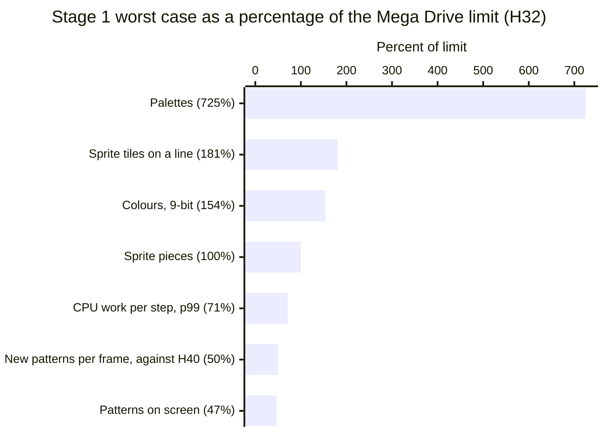
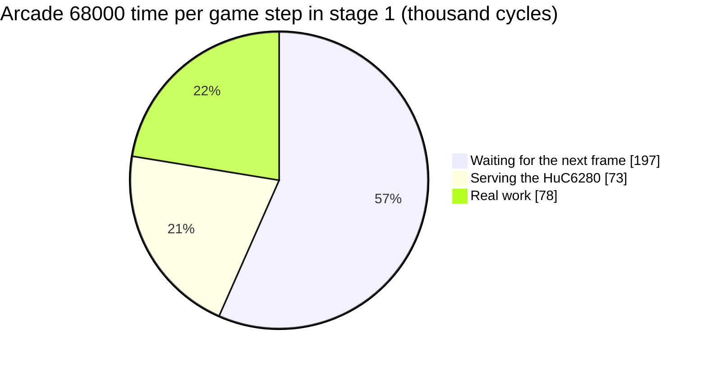

# RoboCop, measured

What the arcade game puts on screen and how hard its CPU works, frame by frame, set against the Mega Drive's limits. [Doc 01](01-architecture-dec0-vs-mega-drive.md) describes the machines; this document is the numbers.

## Method

- MAME 0.289, set `robocop` (World, revision 4), headless, 21,600 frames (6 minutes 16 seconds of arcade time) from power-on.
- A blind input script: coin and start every 1,800 frames; walk right for 200 frames of every 300, stop and aim up or down for 80, step back for 20; fire every 12 frames; jump now and then.
- The player's energy byte (`0xFFB242`) is rewritten to its starting value, 40, every frame, so the run does not end at the first death. The run still ends on the stage timer.
- Three runs with the same script, which are identical frame for frame: video trace (`dec0_trace.lua`), sampling profiler at 12,000 samples a second (`dec0_profile.lua`), hardware access and RAM map (`dec0_access.lua`). A fourth, shorter run of 7,200 frames counts sound chip writes (`dec0_sound.lua`).
- What the run played, from its contact sheet: attract mode; stage 1 from the first street to the ED-209 boss (frames 300–5,400); the first screens of stage 2, an interior with stairs, where the script gets stuck against a step and stands there until the timer runs out (5,400–13,800; only 5,400–7,800 is used below); game over, attract mode and title; stage 1 again.
- "Gameplay frame" means a frame with sprites on screen and tiles in layer 2. Figures are for stage 1 (5,006 frames) unless they say otherwise.

**Everything here is attract mode, stage 1 and the start of stage 2.** The later stages, the shooting gallery and the ending have not been played.

## 1. At a glance

| | Arcade, stage 1 | Mega Drive limit (H32) | Fits? |
|---|---|---|---|
| Game steps per second | 28.7 (one per two frames) | 29.96 | Yes, 4% fast |
| CPU work per step | 77,900 cycles mean, 180,700 at the 99th percentile | 256,023 | Yes, with room for the hardware layer most of the time |
| Sprite pieces (up to 32×32) | 29 mean, 64 max | 64 | Just, with nothing left for a HUD |
| Sprite tiles on a line | 10.5 mean, 29 max | 16 | Not in 11% of frames |
| Patterns on screen | 592 mean, 794 max | about 1,680 | Yes, twice over |
| New patterns per frame | 6 mean, 113 max | about 225 per VBlank in H40; fewer in H32, not pinned down | Yes |
| Palettes of 16 | 23 mean, 29 max | 4 | No: reduction needed |
| Colours, as 9-bit | 72 mean, 94 max | 61 | Close: reduction needed |
| Tile layers | 3 | 2 + window | The text layer needs a home |
| Work RAM written | 6,534 bytes of 16,384 | 64 KB | Yes |

## 2. Sprites

| Per gameplay frame, stage 1 | mean | median | 95th | 99th | max |
|---|---|---|---|---|---|
| Sprite entries with something visible | 27.2 | 25 | 49 | 56 | 63 |
| 16×16 tiles drawn | 43.7 | 41 | 78 | 96 | 102 |
| Distinct tiles | 35.6 | 33 | 65 | 74 | 85 |
| Pieces if each entry is cut into 32×32 sprites | 28.6 | 27 | 51 | 60 | 64 |
| Most tiles on one line | 10.5 | 9 | 20 | 26 | 29 |
| Palettes used by sprites | 4.1 | 4 | 7 | 9 | 11 |
| Entries with the flash bit | 0.6 | 0 | 4 | 8 | 13 |

- An entry is 1.6 tiles on average. Most entries are a single tile or a column of two; the big blocks the hardware allows (up to 8×8 tiles) are rare in stage 1. Cutting by entry gives almost one Mega Drive sprite per entry (1.05).
- **Per frame:** the 64-sprite limit of H32 is reached exactly at the worst moment. With a HUD of about 25 sprites added, 23% of frames would be over 64.
- **Per line:** more than 16 tiles on a line in 11.3% of frames, more than 20 in 4.3%. Sixteen 16-pixel tiles are also exactly the 256-pixel line limit. Merging two tiles side by side into one 32-wide sprite helps the count of 16 but not the 256 pixels.
- The flash bit (draw every other frame) is set on some entry in 12% of frames. The game already flickers things on purpose.
- The sprite list changes in 42% of frames, in step with the game's two-frame rhythm.
- Stage 2's first screens are lighter per line: 8.7 tiles mean, 19 max, over 16 in 0.8% of frames.

## 3. Layers and colour

| Per gameplay frame | Stage 1 mean / max | Stage 2 start mean / max |
|---|---|---|
| Text layer: non-blank cells | 71 / 92 | 70 / 78 |
| Text layer: distinct characters | 29 / 42 | 28 / 35 |
| Text layer: palettes | 6 / 6 | 6 / 6 |
| Layer 2 (street): distinct 16×16 tiles | 81 / 120 | 70 / 101 |
| Layer 2: palettes | 9.6 / 13 | 4.1 / 8 |
| Layer 3 (skyline): distinct 16×16 tiles | 36 / 54 (51 when shown) | none |
| Layer 3: palettes | 3.5 / 5 | none |
| Palettes in use, all layers and sprites | 23.2 / 29 | 15.7 / 21 |
| Distinct colours, 24-bit | 140 / 174 | 102 / 135 |
| Distinct colours, cut to 9-bit | 72 / 94 | 66 / 81 |

Layer registers (**all** 21,600 frames):

- Every layer is 2×2 screens (512×512 pixels), row-major, in every frame but two during start-up.
- Layers 2 and 3 never enable row or column scroll. The text layer enables row scroll in 266 gameplay frames (3%) and is otherwise fixed at scroll position 0, 0.
- The priority register is 0 in every gameplay frame and 6 for 172 frames of the title sequence, where layer 3 is empty and at most 48 sprite tiles are shown.
- Stage 1 never scrolls vertically (both layers stay at Y = 256). Stage 2 does (layer 2 at Y = 336 for most of it).
- Layer 3 is empty in the stage 2 interior, and for part of stage 1.

Colour:

- The arcade's 140 colours are 72 once each channel is cut from 16 levels to the console's 8: half of the arcade's colours differ only in a bit the Mega Drive does not have.
- 72 is still more than 61, and they are spread over 23 sets of 16 where the console has 4. The street alone uses about 10 sets.
- Sprite palettes 8 to 15 are in use (16 entries a frame on average have one). With the priority register at 0 the palette number has no effect on priority; on the title screen it would.

## 4. Graphics on screen

Patterns are 8×8 cells with at least one non-zero pixel, for the full 256×240 picture.

| Per gameplay frame | Stage 1 mean / 95th / max | Stage 2 start mean / max |
|---|---|---|
| Layer 2 patterns | 317 / 436 / 478 | 256 / 376 |
| Layer 3 patterns | 145 / 212 / 216 | 0 |
| Text patterns | 29 / 40 / 42 | 28 / 35 |
| Sprite patterns (at most 4 per distinct tile) | 142 / — / 340 | — |
| Everything visible | 592 / 734 / 794 | 399 / 591 |
| New since the previous frame | 6.2 / 32 / 113 | 4.5 / 75 |

- The largest picture in the whole run is 794 patterns: 47% of the roughly 1,680 that fit beside two planes in H32.
- New patterns never exceeded 129 in a frame (4 KB), and exceeded 100 twice in stage 1. One VBlank carries about 225 patterns in H40 and somewhat fewer in H32, and the game only changes the picture every second frame.
- So the pattern cache can be simple: load what a scene needs, keep everything, evict only at scene changes. The streaming problem that dominated the CPS-1 port does not exist here.

## 5. CPU time

### 5.1 What counts as work

Three kinds of time are not work:

- **The frame wait loops** at `0x17BA` (one frame) and `0x17E8` (two frames), which spin until the VBlank handler has counted enough frames.
- **The loop in the VBlank handler** at `0x1156` that waits for the VBlank flag to drop before returning, about 9,000 cycles a frame.
- **Serving the HuC6280**: copying 1,200 bytes of object records into the dual-port RAM (`0x7620`), waiting for it (`0x763E`, `0x3EF6`, `0x3F2A`, `0x35AE`), and copying them back (`0x7680`). On the Mega Drive the hit detection runs on the 68000 against the records where they are, so the copies and waits disappear and the detection itself is added.

The sampled program counter in MAME sits one instruction ahead, so the address ranges used for these loops extend one instruction past the loop's last branch.

### 5.2 Real work per game step

The game logic runs every second frame, so time is counted per pair of frames: 348,160 arcade cycles, against 256,023 on an NTSC Mega Drive.

| Per game step | Stage 1 | Start of stage 2 |
|---|---|---|
| Real work, mean | 77,900 | 91,300 |
| Real work, median | 73,500 | 83,300 |
| Real work, 95th percentile | 149,100 | 151,100 |
| Real work, 99th percentile | 180,700 | 178,200 |
| Serving the HuC6280, mean | 73,300 | 76,800 |
| Frame wait loops, mean | 196,900 | 180,000 |
| Steps over one Mega Drive frame of real work | 10.9% | 10.3% |
| Steps over two Mega Drive frames of real work | 0.12% | none |

- The mean step needs 30% of two Mega Drive frames; the 99th percentile needs 71%. What is left, 178,000 cycles on average and 75,000 at the 99th percentile, is the budget for the video translation, the hit detection, and the DMA the CPU sleeps through.
- The few steps over two frames in stage 1 are at scene set-up.
- One step in nine needs more than a single Mega Drive frame. The game cannot be run at 60 steps a second, and does not ask to be.
- About 420 samples per step: a single step is uncertain by several thousand cycles. Means and percentiles are over 2,550 steps (stage 1) and 1,200 (stage 2).

### 5.3 Where the real work goes

Share of real-work samples over the whole run, by routine (start addresses from call targets; not yet named from a full disassembly):

| Routine | Share | What it looks like |
|---|---|---|
| `0x7ABA` | 19.7% | Per object: checks it is within 128 pixels of the screen, looks up its frame in a table and writes sprite entries. The sprite list builder |
| `0x2070` | 7.6% | Walks a list of 72-byte records at `0xFF8FC8` and dispatches on a type byte |
| `0x76AE` | 7.4% | Position update and screen-relative box tests for one object |
| `0x1C32` | 5.7% | Not read yet |
| `0x4A40` | 4.8% | Not read yet |
| `0x473C` | 3.9% | Not read yet |
| `0x1816` | 3.5% | Collects sprite entries from several lists into sprite RAM |
| `0x7DC2` | 2.8% | Not read yet |
| Everything else | 44.6% | No routine above 2% |

The sprite path (`0x7ABA` and `0x1816`) is about a quarter of real work. As on CPS-1 it produces the arcade's sprite format, which the hardware layer then has to translate; it is the first routine worth replacing with one that writes Mega Drive sprites directly, if time gets short.

## 6. Hardware use

From the access map of the same run: about 250 instructions touch hardware, in these groups.

| Hardware | Instructions | Note |
|---|---|---|
| Dual-port RAM | 37 | The whole 2 KB is written; besides the HuC6280 exchange the game clears it at start-up |
| Text tilemap | 84 | Read back as well as written |
| RAM at `0x242800` | 33 | `0x242A00–0x243810` in use: ordinary variables that happen to live in the first tilemap chip's address space |
| Layer 2 and 3 tilemaps | 16 | Whole 2 KB of each written |
| Chip registers and scroll tables | 30 | Almost all in the VBlank handler |
| Palette | 14 | Both halves, whole range |
| Inputs | 14 | 4.3 million reads, nearly all the VBlank-flag wait |
| Control registers | 17 | |
| Sprite RAM | 4 | Whole 2 KB written |

Work RAM: 6,534 of 16,384 bytes written after start-up. Eleven blocks of 256 bytes or more were never written, the largest `0xFFB784–0xFFBD8D` (1,546 bytes) and the two shadow scroll tables of layers 2 and 3 (1,152 bytes each).

## 7. Sound

7,200 frames from power-on through stage 1:

| | Use |
|---|---|
| Commands from the 68000 | 57 different values; 1,973 commands in the 21,600-frame run, one every 11 frames |
| YM3812 | All 9 channels keyed, 163 to 462 times each; no rhythm mode |
| YM2203 FM | All 3 channels keyed: channel 0 1,622 times, the others 45 and 126 |
| YM2203 SSG | Two of three channels given volume |
| OKI M6295 | All 4 voices; 15 different samples |
| Sound CPU tick | YM3812 timer reloaded 105,088 times: about 840 a second |

## 8. Consequences for the port

1. **CPU time is not the first problem.** Real work is a third of the budget on average. It becomes a problem only if the video translation is slow, so that layer should be measured from its first version.
2. **Patterns are not a problem at all.** A scene fits in VRAM with half to spare, and a frame's new patterns fit in one VBlank.
3. **Sprites per line are the visible risk.** One frame in nine exceeds what H32 can draw on some line. The options are flicker by rotation (the usual answer), H40 with borders (20 per line: 4% of frames over), or moving crowded-line objects onto a plane.
4. **The HUD cannot simply be sprites** as in the demo if the arcade's enemy counts are kept: 23% of frames would run out of sprites. Candidates: the window plane for the top rows and sprites for the bottom bar, or a window that is switched between top and bottom by an HBlank interrupt.
5. **Colour needs per-scene plans**, from about 23 palettes to 4, with the 9-bit colour count only a little over the limit.
6. **The two-frame step is an asset.** Sprite RAM is latched once per step; the hardware layer has two VBlanks to deliver each picture.
7. **Stage 2 scrolls vertically**, so the plane handling cannot assume a fixed Y as stage 1 would allow.

## 9. Checking the port in an emulator

`tools/check_md.sh` runs a build headless in MAME and reports whether it runs, its sprite and DMA load and its picture; `tools/mame/md_trace.lua` writes the same per-frame columns for the port as for the demo, so the port, the demo and the arcade can be compared with `tools/analysis/summarise_traces.py`.

## 10. Open items

- Stages 2 onward, the shooting gallery, the ending: all unmeasured.
- A scripted run that plays properly (or recorded inputs), so stage 2 is not a figure standing against a step.
- The routines in 5.3 marked "not read yet".
- The sound command list: which values are music, which effects, which samples.
- The cost of hit detection in 68000 code.
- Whether holding the energy byte changes anything else the game does.
