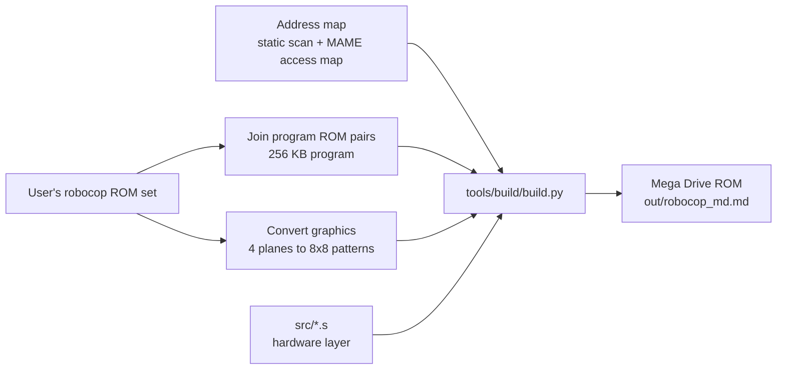

# Port plan

How *RoboCop* gets from the arcade board to a Mega Drive cartridge, in milestones. It builds on the measurements in [doc 01](01-architecture-dec0-vs-mega-drive.md), [doc 02](02-robocop-arcade-vs-md-demo.md) and [doc 03](03-robocop-measured.md).

**Status: milestones 1 to 4 have a first version, in emulators, stage 1 only.** The arcade program boots and plays on the Mega Drive with sprites, both scrolling layers, the text layer, music, effects and samples. The picture is checked in MAME and ares; the sound only in MAME, by measurement, and nobody has listened to it yet. Each milestone lists what has to be true before it counts as done.

## Decisions

| Decision | Choice | Why |
|---|---|---|
| Game code | Data East's original 68000 program, run in place | Same CPU; the game's RAM is inside the console's at the same addresses; logic is then identical by construction. Its real work is a third of two Mega Drive frames on average |
| The HuC6280 | Its two jobs rewritten in 68000 assembly, inside the hardware layer | Its program is 924 readable bytes in the 68000 ROM. Emulating a second CPU would cost more time than the arcade's waits did |
| New code | 68000 assembly, GNU binutils (`m68k-elf-as`, `m68k-elf-ld`) | The arcade code has its own interrupt handler and register habits; a C runtime such as SGDK would fight them. Same tool chain as Cadillacs and Dinosaurs MD |
| Game data | Taken from the user's ROM set at build time | The repository holds no Data East data; built ROMs are never committed |
| Hardware addresses | Rewritten in place to copies in spare RAM | They are 32-bit constants in the instructions; 46 KB of console RAM is unused by the game |
| Picture | H32, 256×224, NTSC first | The arcade's width exactly, as the demo shows. To be revisited at milestone 2 if sprites per line cannot be managed |
| Game speed | One step per two frames | What the arcade does; 4% faster on NTSC |
| Cartridge | Flat, no mapper | All content is about 1.3 MB |
| Reference for video | The RoboCop MD demo's layout (doc 02) | Layer 2 on plane A, layer 3 on plane B, one palette line each |
| Emulator for checks | MAME `genesis`, headless | Scriptable; BlastEm or ares for hands-on play |

## How the build works

`build_md.py` takes the user's `robocop.zip`, checks the four program ROMs by size and CRC32, joins them, and `tools/build/build.py` then:

1. **Redirects every hardware address** to its copy in RAM by rewriting the 32-bit constant in place (same instruction, same size): 273 instruction operands, found by scanning for values in the hardware ranges and keeping those that are the operand of a valid instruction.
2. **Redirects pointers held in data**: 228 long values in the tilemap, palette and `0x242800` ranges that follow a routine's `rts`, sit in a run of such pointers, or follow a list terminator (the text printer's lists are `pointer, characters..., 0xFFFE, pointer, ...`). Values in the dual-port RAM's and the registers' ranges are never treated as data pointers: `0x0018` and `0x0024` followed by a small number are common in word tables.
3. **Replaces the vector table and the header page.** Reset and VBlank (level 6) go to the hardware layer, which calls Data East's handler after reading the pad.
4. **Replaces the exchanges with the HuC6280** (below).
5. **Appends** the hardware layer after the program at `0x040000`, tables of blank tiles and characters at `0x070000`, and the graphics converted to Mega Drive patterns: sprite tiles at `0x080000` and `0x100000`, layer tiles at `0x180000`, characters at `0x1E0000`; then the sound: a table of streams at `0x200000`, the streams, the sample table and Z80 program at `0x27F000`, and the samples at `0x280000`. The ROM is 4 MB, flat.

About 210 values in hardware ranges are left alone as coincidences. The check for a missed one is dynamic: `tools/mame/md_state.lua` records every access the running build makes to an arcade hardware address, which on the Mega Drive is cartridge space. In 9,000 frames of play through stage 1 and into stage 2 there were none.

### The HuC6280's jobs

| Arcade | Mega Drive build |
|---|---|
| Start-up handshake and program upload (`0x100–0x22B`) | Gone with the header page; `hal_boot` does the cold start's other steps in the same order |
| Main loop sync (`0x35A6`: write `0x80`, wait for `0x81`) | The write stores `0x81` |
| Routine sequencer (`0x3EEE`) | `hal_sequence`: reads the 18 routine numbers from the HuC6280 program's own table in the 68000 ROM (`0xD7BF`) and calls each through the game's table at `0x3F38` |
| Interrupt at `0x7630` (`clr.w $180ffe`) | `jsr hal_hit`: a 68000 transcription of the HuC6280's interrupt routine, working on the same bytes in the dual-port RAM's stand-in and reading the box tables from the 68000 ROM |
| The two jumps to the restart code at `0x1BC`, inside the header page | Re-aimed at a trampoline at `0x200` |

The game's own copies of the 1,200 bytes of object records into the dual-port RAM and back are taken out (the two copy loops at `0x761C` and `0x767C` are skipped), and `hal_hit` reads and marks the records where the game keeps them, at `0xFF983C`. They cost about 54,000 cycles per step on the arcade. This is safe because nothing reads or writes the records between the send and the copy back: checked on the arcade with read and write taps over 6,000 frames. The player's values (energy, position, flags) still go through the stand-in, because the game applies the returned energy conditionally.

**How the hit detection was checked.** `tools/mame/hit_capture.lua` records the dual-port RAM before and after each exchange, on the arcade and on the build. `tools/analysis/hit_model.py` holds a model of the HuC6280 routine and compares:

| Capture | Steps | With objects | With a record marked | With energy taken | Differ from the model |
|---|---|---|---|---|---|
| Arcade (real HuC6280 program in MAME) | 1,619 | 568 | 31 | 28 | 0 |
| Mega Drive build, records copied as on the arcade | 1,606 | 518 | 29 | 26 | 0 |
| Mega Drive build, records in place (current) | 1,125 | 619 | 32 | 31 | 0 |

So the model equals the HuC6280 on everything the arcade run produced, and the 68000 routine equals the model on everything the build's run produced. The two runs are not the same game (see milestone 1), and neither reached object types that only appear later.

### Memory

| Arcade | Mega Drive build |
|---|---|
| Program `0x000000–0x03FFFF` | Same addresses |
| Work RAM `0xFF8000–0xFFBFFF` | Same addresses |
| Sprite RAM `0xFFC000–0xFFC7FF` | Same addresses |
| Palette, red and green `0x310000–0x3107FF` | `0xFF0000–0xFF07FF` |
| Palette, blue `0x314000–0x3147FF` | `0xFF4000–0xFF47FF` |
| Text layer registers `0x240000–0x24001F` | `0xFF0800` |
| Layer 2 registers `0x246000–0x24601F` | `0xFF0820` |
| Layer 3 registers `0x24C000–0x24C01F` | `0xFF0840` |
| Inputs and control `0x30C000–0x30C01F` | `0xFF0860` |
| Dual-port RAM `0x180000–0x180FFF` | `0xFF1000–0xFF1FFF`, same layout (one byte per word) |
| Text layer scroll tables and plain RAM `0x242000–0x243FFF` | `0xFF2000–0xFF3FFF` |
| Layer 2 tilemap `0x24A000–0x24A7FF` | `0xFF4800–0xFF4FFF` |
| Layer 3 tilemap `0x24D000–0x24D7FF` | `0xFF5000–0xFF57FF` |
| Layer 2 scroll tables `0x248000–0x2487FF` | `0xFF5800–0xFF5FFF` |
| Text tilemap `0x244000–0x245FFF` | `0xFF6000–0xFF7FFF` |
| Layer 3 scroll tables `0x24C800–0x24CFFF`, and `0x24E000–0x24E7FF` where the game's VBlank handler writes them | `0xFFC800–0xFFCFFF` |
| Hardware layer, sprites | Variables `0xFFD000`, sprite table copy `0xFFD100`, upload queue `0xFFD300`, cache slot tables `0xFFD500–0xFFD6EF`, converted palettes `0xFFD700`, slot-of-key table `0xFFE000–0xFFF1FF`, palette use counts `0xFF1600` |
| Hardware layer, tile layers | Slot tables `0xFF0880–0xFF0BBD`, layer records `0xFF0C40`, drawn bits `0xFF0C80–0xFF0D7F`, colour owners `0xFF0D80`, lines 2 and 3 `0xFF0DC0`, variables `0xFF0E00`, full arcade colours `0xFF1240`, colour selection work area `0xFF1300–0xFF15FF`, drawn map copies `0xFFD800–0xFFDFFF` and `0xFFF200–0xFFF9FF`, hash table `0xFFFA00–0xFFFDFF`, pen tables `0xFFFE00–0xFFFFFF` |
| Hardware layer, sound | Command queue and the two streams' positions `0xFF1620–0xFF165B` |
| Hardware layer, text | Block checksums and slots `0xFF0E40–0xFF0FCB`, variables `0xFF1040`, character cache keys `0xFF1100–0xFF123F`, pen tables `0xFFD740–0xFFD7FF` |

The dual-port RAM's stand-in is 4 KB, but with the record copies gone the game only touches its first 36 bytes; the hardware layer uses `0xFF1040–0xFF1FFF` of it. If a later stage turns out to use the dual-port RAM as plain storage, those tables have to move.

The two palette halves have to stay `0x4000` apart: the game keeps one pointer and adds `0x4000` to reach the blue half (`0x132C`). On real hardware the Mega Drive mirrors work RAM through `0xE00000–0xFFFFFF`, which does not matter here because no arcade address is in that range.

## Milestones

### 1. The arcade program runs on the Mega Drive — done (emulator)

`src/hal.s` (942 bytes) boots the console, reads pad 1 into the arcade's input words (B attack, C jump, A coin, Start start; DIP switches at MAME's defaults), and stands in for the HuC6280. Checked in MAME's `genesis` driver with `tools/mame/md_state.lua`, which reads the game's own variables:

- The game runs its attract mode, takes a coin and a start, and plays: under the blind play script the player's position and the scroll advance through stage 1 and into stage 2, the step counter advances once per two frames, enemy hits take energy off, and a death restarts play.
- No access to an unredirected hardware address in 9,000 frames.
- The hit detection equals the HuC6280's (table above).

Not done, and not possible as first planned: tracking the arcade's state step for step under the same inputs. The game's random numbers come from a counter that the frame wait loop spins (`0xFF8008`), so they depend on how long each step took, and the two machines diverge within seconds. Comparisons between arcade and build are therefore statistical, or made on one routine at a time as for the hit detection.

There is no picture: the display is on and blank.

### 2. Sprites — done (emulator), flicker handling open

`src/sprites.s`. The two writes to the sprite latch (`0x1010` in the VBlank handler, `0x1B86`) call `hal_sprites`, which walks sprite RAM as the MXC06 does and builds the Mega Drive sprite table in RAM; the next VBlank sends the new patterns, the table and the palettes.

- **Pieces.** An arcade entry is a column of 1, 2, 4 or 8 tiles. A single tile becomes a 16×16 sprite, a taller column 16×32 sprites. Tile pairs are always aligned (the chip rounds the tile code down to a multiple of the height), so the build stores every tile twice: once alone (4 patterns) and once stacked with its neighbour (8 patterns, in the column order a Mega Drive sprite wants). 384 KB each, at `0x080000` and `0x100000`.
- **Pattern cache.** 120 slots of 8 patterns at VRAM `0x4000–0xB7FF`, keyed by tile or tile pair, with a byte per key saying which slot holds it. A slot not used in the current list can be taken; a clock hand picks the victim.
- **Order.** Table entry 0 is an off-screen sprite that heads the chain; pieces are linked last to first so the arcade's last entry is on top.
- **Palettes.** Lines 0 to 2. An arcade sprite palette gets a line when it appears and keeps it while in use; a fourth palette in one list borrows line 0. Colours are cut from 8 bits per channel to 3 at each latch, so fades follow.
- **Flash bit**: honoured on alternate latches.
- **Vertical crop**: arcade lines 16 to 239 are shown.

Measured in MAME over 7,746 gameplay frames (stage 1 with its boss, start of stage 2, energy held):

| | mean | 95th | max |
|---|---|---|---|
| Sprites in the table | 31.5 | 56 | 63 |
| Sprites on one line | 11.5 | 20 | 31 |
| VRAM DMA bytes per frame | 318 | 1,024 | 5,504 |

- 17 pieces were dropped for lack of a table entry in the whole run.
- **13.4% of frames have more than 16 sprites on some line**, as the arcade trace predicted (11%). The console drops the ones last in the chain, which are the arcade's first entries. Nothing rotates the order yet, so they vanish instead of flickering.
- The game still runs one step per two frames throughout.
- Side by side with arcade snapshots the sprites match in shape and colour. Sprites that share line 0 with a fourth palette have not been looked for.

### 3. Backgrounds, text and palettes — done for stage 1 (emulators), with known faults

**Tile layers** (`src/bg.s`). Layer 2 (the street) is on plane A and layer 3 (the skyline) on plane B, both 64×64 cells, the same 512×512 pixels as the arcade's maps, so scroll values carry over directly (horizontal negated, vertical plus the 16 cropped lines).

- **Finding what changed.** The game writes its maps straight into RAM through 13 instructions. At each update one layer's map is compared with a copy of what has been recorded (the layers take turns); a changed entry gives its tile back and is marked not drawn.
- **Window.** Only the 19 × 17 tiles around the screen are kept drawn. When the scroll crosses a tile boundary, tiles that left the window give their slot back and the ones that entered are drawn. Drawing the whole map, as the first version did, needs more distinct tiles than VRAM has: the off-screen part of the arcade's map holds columns left over from earlier in the stage.
- **Tile cache.** 207 slots of 4 patterns at VRAM patterns `0x004–0x33F`, keyed by tile and arcade palette through a 256-entry hash table, with a count of cells per slot. At most 8 new tiles and 160 tile draws per update in play.

**Colour.** Sprites have palette lines 0 and 1, layer 2 line 2, layer 3 line 3.

- A tile's pixels are renumbered as it is copied into VRAM, through a table per arcade palette that gives each pen a colour number on its layer's line.
- **The colours on a line are chosen when a scene is loaded**, from the layer's whole block of 16 arcade palettes: starting from black, the colour farthest from all those already chosen is added until the line is full. Each pen then takes the nearest. The first version handed colours out in the order tiles were first drawn; whatever scrolled in later got a nearest match, and the yellow and red of a shop sign became brown.
- Layer 3 is opaque on the arcade, so its pen 0 is a real colour; it maps to colour 0 of line 3, which is shown as the backdrop.
- Each console colour remembers the arcade palette entry it came from and is recomputed when the game changes its palette, so fades and palette animation follow.
- **Scene loads.** The game draws a stage while its palettes are still black. The layers wait while their palettes are black. When a palette arrives the display goes off, the palette is given a few updates to stop changing (12 at most, for scenes that animate theirs), then the colours are chosen, the whole window is drawn in one go, and the display comes back on. A scene whose colour tables stop matching its palettes is reloaded the same way.
- **Sprite palettes.** The two palettes used by the most sprites own lines 0 and 1. Any other sprite palette is shown with the line whose owner's colours are closest to its own, pen for pen.

**Text** (`src/text.s`). The visible 32 × 28 characters are divided into blocks of 4 × 2, with a checksum per block to see changes (a quarter of the blocks are checked per update).

- **On a plane, when one is free.** Every text-heavy arcade screen leaves one tile layer blank: the high-score page leaves layer 2 blank, the title page layer 3, the message pages both. The text is then written into the blank layer's plane as high-priority cells, each character loaded into VRAM once (160 patterns).
- **As sprites, otherwise.** In the stages, where both layers are in use, a block with anything in it owns eight patterns and is shown as one 32×16 sprite in front of the game's sprites: 20 blocks at most, enough for the score, timer, weapon box and energy bar. The window plane was not used because it replaces plane A wherever it shows, and the HUD sits over the street.
- Text is drawn with line 2. Two of that line's colours are kept back for it.
- When the sprite table cannot hold both the HUD and all the game's sprites, they take turns to lose pieces.
- The game's "curtain" (the text layer filled with one solid character while a scene is set up) is detected from sixteen sampled cells and shown as the display switched off.
- Text screens never latch the sprite list, so when no latch has come for four frames the layers and text are updated from VBlank.

Measured in MAME, stage 1 with its boss and the start of stage 2, energy held, 7,200 frames:

- 3,388 game steps: 94% of one per two frames. 361 VBlanks missed, at scene loads.
- 135 to 137 of the 207 tile slots in use in stage 1; the cache never filled.
- 32.8 sprites in the table on average, 62 at most; more than 16 on a line in 1.9% of frames.
- 1,273 sprite pieces lost to the full table over the run, mostly in the boss fight.
- No access to an unredirected hardware address.

Seen in ares (attract sequence only; ares takes no scripted input): the title page, the message pages, the start-up text and the gameplay demo with its HUD are drawn as in MAME.

Known faults:

- **High-score page**: the portrait behind the table does not appear in ares and some of the table's cells are missing; in MAME the table is complete and the portrait comes and goes.
- **Story pages** (the pictures with captions before the title) were black in the ares captures.
- The title logo shows speckles.
- Game speed is 6% under the arcade's in stage 1.
- The street has 13 colours for the arcade's 40: shades merge, and one shop sign loses its green.
- A scene change blanks the screen for a fraction of a second.
- The top 8 and bottom 8 lines of the arcade picture are cut off, and the score sits on the very top line.
- The text layer's row scroll, used in 3% of gameplay frames, is ignored.
- Sprites over 16 on a line vanish instead of flickering.

### 4. Sound — first version (MAME only, not yet listened to)

The arcade's 6502 sound program is not run on the console. **It is run at build time**: `tools/build/sound6502.py` is an emulator of the sound board (65C02, the YM3812's timer as its interrupt, the sound latch as NMI, the OKI's busy flags), and each sound command is played alone in it while its chip writes are logged. `tools/build/sound.py` turns each log into a stream of YM2612 and PSG writes per frame. The build keeps the result in a `cache` folder beside the ROM, because the emulation takes about two and a half minutes.

The emulator against MAME, on the first 40 seconds of MAME's own log of the game: the same 178 OKI writes, 7,197 YM2203 writes against 7,188 and 4,490 YM3812 writes against 4,404, in slightly different order where cycle timing decides which of two channels is written first.

**What the commands are** (each run alone, `tools/analysis/sound_survey.py`):

| Commands | What | Chips on the arcade |
|---|---|---|
| `0x01`–`0x04` | Stop and reset | — |
| `0x05`–`0x30` | 44 effects | One YM2203 FM channel each, a few with a square-wave channel |
| `0x31`–`0x3D` | 13 tunes: ten that repeat (7 to 108 seconds) and three played once | YM3812, up to nine voices; five tunes add YM2203 FM voices |
| `0x3E`–`0x4F` | Stop samples; 17 samples | OKI M6295 |

**Conversion.**

- **YM3812 voice → two YM2612 operators.** The game uses the YM3812 as plain two-operator FM: no waveform select, no rhythm mode (register log). Multiple, level, attack, decay, sustain and release map across; a percussive envelope becomes a second decay; feedback carries over. Frequencies are rescaled for the two chips' sample rates (× 1.564).
- **YM2203 FM voice → one YM2612 channel**, register for register, frequency × 0.391.
- **Square waves → PSG**, period × 4.77, volume in 2 dB steps; envelope mode is taken as a fixed level and noise as white noise.
- **Places.** Tunes have channels 1, 2 and 4 whole and channel 3 in its separate-frequency mode as two two-operator voices: five places for up to nine voices. A voice keeps its place from note to note; a new one takes a free place, or the place of the voice released longest ago, or failing that the one keyed longest ago. Between a third and a half of all notes take a place that way.
- **Effects** have channel 5 and the PSG; a new effect replaces the one playing.
- **Repeats** are found in the write log itself: the last 400 writes are looked for earlier in the log and the match extended backwards. The driver's memory never returns to an earlier state (it keeps a free-running counter).
- **Samples** are decoded from the OKI's ADPCM to 8-bit PCM at build time (125 KB) and played by the Z80 through the DAC on channel 6, one at a time, at about 7,600 a second (the arcade's 7,575). The Z80's program is 100 bytes, assembled by `sound.py`.

**On the console** (`src/sound.s`). The five places where the game writes a sound command call `hal_sound`, which queues it. Each VBlank the 68000 takes the bus from the Z80, starts streams and samples for the queued commands, plays this frame's writes of the tune and effect streams, leaves the YM2612's address port on the DAC register and gives the bus back.

Checked in MAME:

- The pitch content of the port's audio against the arcade's over the same attract-mode music (`tools/analysis/compare_audio.py`, chroma per tenth of a second): agreement 0.64 with the port unshifted, 0.19 to 0.47 shifted by any number of semitones. The notes are the right ones at the right time.
- The Z80 plays samples when the game asks: 13 to 28 samples started per ten seconds of play, each followed by its bank switch and its bytes written to the DAC. The playback rate itself is from counting the routine's cycles, not from a measurement.
- No clipping; game speed and stray accesses unchanged.

Not checked, and likely wrong in places:

- **Nobody has listened to it.** Timbres come from a mechanical mapping of envelope rates and levels between two different chip families; instrument balance, attack and decay speeds and modulation depth are untested by ear.
- Voices dropped by the five-place limit: which ones are missed has not been judged.
- A note held across a tune's repeat point may hang or cut.
- Only one sample plays at a time (the arcade has four voices), and the DAC pauses while the 68000 holds the bus each frame.
- Effects take one FM channel: the two effects that use two lose one.
- Vibrato and tremolo are ignored.
- Sound has not been run in ares beyond confirming the build still boots there.

### 5. Whole game

- Trace every stage on the arcade (doc 03's method) and fix what each one adds: new hardware accesses, layer modes, palettes, the shooting gallery, the ending.
- Two players, continue, high scores, an options screen in place of the DIP switches.
- PAL: 240 lines and 50 Hz.
- **Done when** the game can be played from coin to ending.

### 6. Real hardware

- Nothing may touch an address the console does not have. Timing of DMA and VDP access checked in BlastEm, then on a console with a flash cart.

## Open problems

- **Sprites per line and per frame** in H32 against the arcade's crowds plus a sprite HUD (doc 03, section 2).
- **Colour**: 13 street colours, two sprite lines.
- **Sound by ear**: the conversion is mechanical and unheard.
- **CPU time**: stage 1 runs 6% slow; comparing a tile map each update and renumbering tile pixels are the main costs left.
- **The music arrangement**: twelve FM voices on two chip types into six.
- **Everything after stage 1** is unmeasured.

## The attract sequence

Checked against arcade snapshots taken at matching points, in MAME and in ares.

- High-score page: the table and the portrait behind it are drawn. The portrait's palette pulses through black; the scene is kept across black when its maps are unchanged.
- Story pages, the three pictures and the title logo are drawn with the arcade's colours: each of these scenes uses few enough palettes for every pen to have its own line colour.
- The title sets the priority register to 6. The logo's face is sprites behind layer 2, so layer 2 is drawn with high-priority cells while bit 1 is set.
- Not right yet: the white flash on the title lasts longer than the arcade's and loses some text; at the end of the title the static of layer 3 shows in a band behind the whole logo, where the arcade shows it only inside the letters (not understood: on the arcade both layers hold the same tiles as here).

