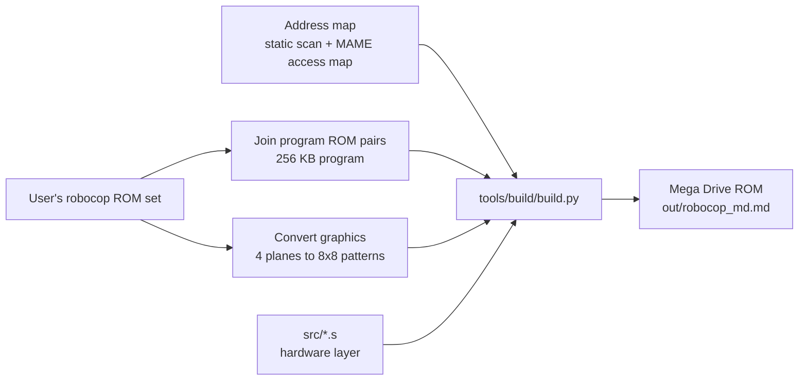

# Port plan

How *RoboCop* gets from the arcade board to a Mega Drive cartridge, in milestones. It builds on the measurements in [doc 01](01-architecture-dec0-vs-mega-drive.md), [doc 02](02-robocop-arcade-vs-md-demo.md) and [doc 03](03-robocop-measured.md).

**Status: milestone 1 is done in an emulator.** The arcade program boots and plays on the Mega Drive in MAME with no picture yet. Each milestone lists what has to be true before it counts as done.

## Decisions

| Decision | Choice | Why |
|---|---|---|
| Game code | Data East's original 68000 program, run in place | Same CPU; the game's RAM is inside the console's at the same addresses; logic is then identical by construction. Its real work is a third of two Mega Drive frames on average |
| The HuC6280 | Its two jobs rewritten in 68000 assembly, inside the hardware layer | Its program is 924 readable bytes in the 68000 ROM. Emulating a second CPU would cost more time than the arcade's waits did |
| New code | 68000 assembly, GNU binutils (`m68k-elf-as`, `m68k-elf-ld`) | The arcade code has its own interrupt handler and register habits; a C runtime such as SGDK would fight them. Same tool chain as Cadillacs and Dinosaurs MD |
| Game data | Taken from the user's ROM set at build time | The repository holds no Data East data; built ROMs are never committed |
| Hardware addresses | Rewritten in place to copies in spare RAM | They are 32-bit constants in the instructions; 46 KB of console RAM is unused by the game |
| Picture | H32, 256×224, NTSC first | The arcade's width exactly, as the demo shows. To be revisited at milestone 2 if sprites per line cannot be managed |
| Game speed | One step per two frames | What the arcade does; 4% faster on NTSC |
| Cartridge | Flat, no mapper | All content is about 1.3 MB |
| Reference for video | The RoboCop MD demo's layout (doc 02) | Layer 2 on plane A, layer 3 on plane B, one palette line each |
| Emulator for checks | MAME `genesis`, headless | Scriptable; BlastEm or ares for hands-on play |

## How the build works

`build_md.py` takes the user's `robocop.zip`, checks the four program ROMs by size and CRC32, joins them, and `tools/build/build.py` then:

1. **Redirects every hardware address** to its copy in RAM by rewriting the 32-bit constant in place (same instruction, same size): 273 instruction operands, found by scanning for values in the hardware ranges and keeping those that are the operand of a valid instruction.
2. **Redirects pointers held in data**: 228 long values in the tilemap, palette and `0x242800` ranges that follow a routine's `rts`, sit in a run of such pointers, or follow a list terminator (the text printer's lists are `pointer, characters..., 0xFFFE, pointer, ...`). Values in the dual-port RAM's and the registers' ranges are never treated as data pointers: `0x0018` and `0x0024` followed by a small number are common in word tables.
3. **Replaces the vector table and the header page.** Reset and VBlank (level 6) go to the hardware layer, which calls Data East's handler after reading the pad.
4. **Replaces the exchanges with the HuC6280** (below).
5. **Appends** the hardware layer after the program at `0x040000`.

About 210 values in hardware ranges are left alone as coincidences. The check for a missed one is dynamic: `tools/mame/md_state.lua` records every access the running build makes to an arcade hardware address, which on the Mega Drive is cartridge space. In 9,000 frames of play through stage 1 and into stage 2 there were none.

### The HuC6280's jobs

| Arcade | Mega Drive build |
|---|---|
| Start-up handshake and program upload (`0x100–0x22B`) | Gone with the header page; `hal_boot` does the cold start's other steps in the same order |
| Main loop sync (`0x35A6`: write `0x80`, wait for `0x81`) | The write stores `0x81` |
| Routine sequencer (`0x3EEE`) | `hal_sequence`: reads the 18 routine numbers from the HuC6280 program's own table in the 68000 ROM (`0xD7BF`) and calls each through the game's table at `0x3F38` |
| Interrupt at `0x7630` (`clr.w $180ffe`) | `jsr hal_hit`: a 68000 transcription of the HuC6280's interrupt routine, working on the same bytes in the dual-port RAM's stand-in and reading the box tables from the 68000 ROM |
| The two jumps to the restart code at `0x1BC`, inside the header page | Re-aimed at a trampoline at `0x200` |

The game's own copies of the object records into the dual-port RAM and back are kept for now. They cost about 54,000 cycles per step on the arcade; removing them is an optimisation for later.

**How the hit detection was checked.** `tools/mame/hit_capture.lua` records the dual-port RAM before and after each exchange, on the arcade and on the build. `tools/analysis/hit_model.py` holds a model of the HuC6280 routine and compares:

| Capture | Steps | With objects | With a record marked | With energy taken | Differ from the model |
|---|---|---|---|---|---|
| Arcade (real HuC6280 program in MAME) | 1,619 | 568 | 31 | 28 | 0 |
| Mega Drive build | 1,606 | 518 | 29 | 26 | 0 |

So the model equals the HuC6280 on everything the arcade run produced, and the 68000 routine equals the model on everything the build's run produced. The two runs are not the same game (see milestone 1), and neither reached object types that only appear later.

### Memory

| Arcade | Mega Drive build |
|---|---|
| Program `0x000000–0x03FFFF` | Same addresses |
| Work RAM `0xFF8000–0xFFBFFF` | Same addresses |
| Sprite RAM `0xFFC000–0xFFC7FF` | Same addresses |
| Palette, red and green `0x310000–0x3107FF` | `0xFF0000–0xFF07FF` |
| Palette, blue `0x314000–0x3147FF` | `0xFF4000–0xFF47FF` |
| Text layer registers `0x240000–0x24001F` | `0xFF0800` |
| Layer 2 registers `0x246000–0x24601F` | `0xFF0820` |
| Layer 3 registers `0x24C000–0x24C01F` | `0xFF0840` |
| Inputs and control `0x30C000–0x30C01F` | `0xFF0860` |
| Dual-port RAM `0x180000–0x180FFF` | `0xFF1000–0xFF1FFF`, same layout (one byte per word) |
| Text layer scroll tables and plain RAM `0x242000–0x243FFF` | `0xFF2000–0xFF3FFF` |
| Layer 2 tilemap `0x24A000–0x24A7FF` | `0xFF4800–0xFF4FFF` |
| Layer 3 tilemap `0x24D000–0x24D7FF` | `0xFF5000–0xFF57FF` |
| Layer 2 scroll tables `0x248000–0x2487FF` | `0xFF5800–0xFF5FFF` |
| Text tilemap `0x244000–0x245FFF` | `0xFF6000–0xFF7FFF` |
| Layer 3 scroll tables `0x24C800–0x24CFFF`, and `0x24E000–0x24E7FF` where the game's VBlank handler writes them | `0xFFC800–0xFFCFFF` |
| Hardware layer's variables | From `0xFFD000`; `0xFF0880–0xFF0FFF` and `0xFFD000–0xFFFFFF` are free |

The two palette halves have to stay `0x4000` apart: the game keeps one pointer and adds `0x4000` to reach the blue half (`0x132C`). On real hardware the Mega Drive mirrors work RAM through `0xE00000–0xFFFFFF`, which does not matter here because no arcade address is in that range.

## Milestones

### 1. The arcade program runs on the Mega Drive — done (emulator)

`src/hal.s` (942 bytes) boots the console, reads pad 1 into the arcade's input words (B attack, C jump, A coin, Start start; DIP switches at MAME's defaults), and stands in for the HuC6280. Checked in MAME's `genesis` driver with `tools/mame/md_state.lua`, which reads the game's own variables:

- The game runs its attract mode, takes a coin and a start, and plays: under the blind play script the player's position and the scroll advance through stage 1 and into stage 2, the step counter advances once per two frames, enemy hits take energy off, and a death restarts play.
- No access to an unredirected hardware address in 9,000 frames.
- The hit detection equals the HuC6280's (table above).

Not done, and not possible as first planned: tracking the arcade's state step for step under the same inputs. The game's random numbers come from a counter that the frame wait loop spins (`0xFF8008`), so they depend on how long each step took, and the two machines diverge within seconds. Comparisons between arcade and build are therefore statistical, or made on one routine at a time as for the hit detection.

There is no picture: the display is on and blank.

### 2. Sprites

Sprite RAM translated to the Mega Drive sprite table at each latch.

- Tile conversion at build time; pattern cache keyed by tile code; flip bits; the link chain built in reverse (the arcade's last entry is on top).
- Entries cut into pieces of up to 32×32; blank cells skipped.
- The flash bit.
- Per-line overflow: rotation, so that dropout becomes flicker. Measure how often it shows. If it is bad, try H40 with borders before anything cleverer.
- **Done when** stage 1's sprites match the arcade's side by side in snapshots, and the trace shows how many frames exceed the line limits.

### 3. Backgrounds, text and palettes

- Layer 2 on plane A and layer 3 on plane B: each 16×16 tile as four cells, drawn from the redirected tilemaps when the game changes them; horizontal and vertical scroll from the redirected registers.
- Palette reduction: a plan per scene from the arcade's palettes to four lines, tile pixels remapped at upload. Start with the Cadillacs approach (shared background line, nearest-colour mapping), then improve per scene.
- The text layer: decide between window and sprites after milestone 2 has shown the sprite budget. Row scroll on the text layer where the game uses it.
- 224 lines: decide which 16 lines go, per screen type.
- The priority register (title screen).
- **Done when** stage 1 plays start to finish in MAME with the picture complete, at full speed.

### 4. Sound

- Sound commands captured at `0x19C6` and the coin handler.
- Samples: the 17 ADPCM samples decoded at build time, played by a Z80 PCM driver.
- Music: read the sequence format out of the 6502 program, then convert: YM2203 channels to YM2612 channels, YM3812 voices arranged onto the rest, square waves to the PSG.
- **Done when** every command the game sends in a full playthrough produces the right sound.

### 5. Whole game

- Trace every stage on the arcade (doc 03's method) and fix what each one adds: new hardware accesses, layer modes, palettes, the shooting gallery, the ending.
- Two players, continue, high scores, an options screen in place of the DIP switches.
- PAL: 240 lines and 50 Hz.
- **Done when** the game can be played from coin to ending.

### 6. Real hardware

- Nothing may touch an address the console does not have. Timing of DMA and VDP access checked in BlastEm, then on a console with a flash cart.

## Open problems

- **Sprites per line** in H32 against the arcade's crowds (doc 03, section 2).
- **Where the HUD goes** without spending the sprite budget.
- **Proving the hit detection rewrite** equal to the HuC6280's.
- **The music arrangement**: twelve FM voices on two chip types into six.
- **Everything after stage 1** is unmeasured.
