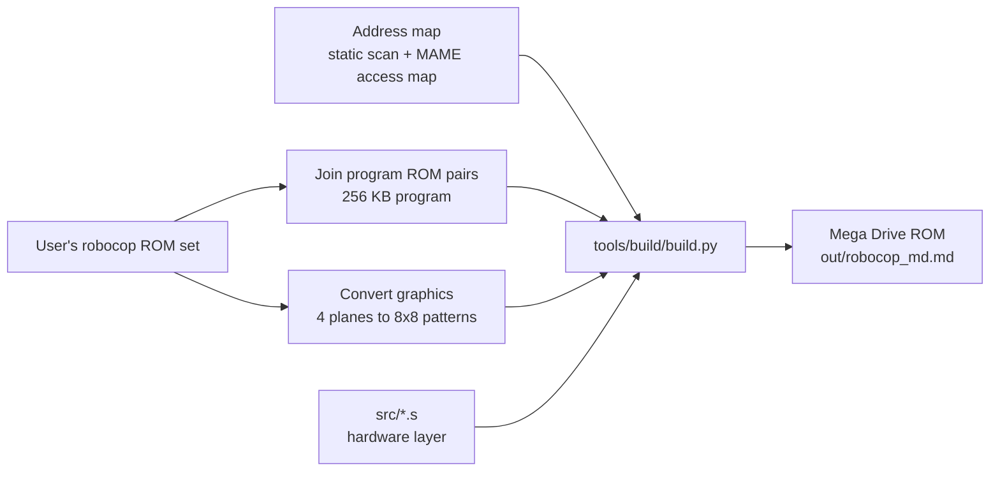

# Port plan

How *RoboCop* gets from the arcade board to a Mega Drive cartridge, in milestones. It builds on the measurements in [doc 01](01-architecture-dec0-vs-mega-drive.md), [doc 02](02-robocop-arcade-vs-md-demo.md) and [doc 03](03-robocop-measured.md).

**Status: nothing is built yet.** This is the plan the measurements point to. Each milestone lists what has to be true before it counts as done.

## Decisions

| Decision | Choice | Why |
|---|---|---|
| Game code | Data East's original 68000 program, run in place | Same CPU; the game's RAM is inside the console's at the same addresses; logic is then identical by construction. Its real work is a third of two Mega Drive frames on average |
| The HuC6280 | Its two jobs rewritten in 68000 assembly, inside the hardware layer | Its program is 924 readable bytes in the 68000 ROM. Emulating a second CPU would cost more time than the arcade's waits did |
| New code | 68000 assembly, GNU binutils (`m68k-elf-as`, `m68k-elf-ld`) | The arcade code has its own interrupt handler and register habits; a C runtime such as SGDK would fight them. Same tool chain as Cadillacs and Dinosaurs MD |
| Game data | Taken from the user's ROM set at build time | The repository holds no Data East data; built ROMs are never committed |
| Hardware addresses | Rewritten in place to copies in spare RAM | They are 32-bit constants in the instructions; 46 KB of console RAM is unused by the game |
| Picture | H32, 256×224, NTSC first | The arcade's width exactly, as the demo shows. To be revisited at milestone 2 if sprites per line cannot be managed |
| Game speed | One step per two frames | What the arcade does; 4% faster on NTSC |
| Cartridge | Flat, no mapper | All content is about 1.3 MB |
| Reference for video | The RoboCop MD demo's layout (doc 02) | Layer 2 on plane A, layer 3 on plane B, one palette line each |
| Emulator for checks | MAME `genesis`, headless | Scriptable; BlastEm or ares for hands-on play |

## How the build will work

`build_md.py` will take the user's `robocop.zip`, check each file by size and CRC32, and:

1. **Redirect every hardware address** to its copy in RAM by rewriting the 32-bit constant in place (same instruction, same size). The list comes from the static scan (`tools/analysis/codemap.py`) checked against the access map of what really executed; a value that is not the operand of a decoded instruction is left alone and reported.
2. **Replace the first 512 bytes**: vector table and Mega Drive header. Reset goes to the hardware layer; VBlank (level 6) goes to the hardware layer, which then calls Data East's handler.
3. **Replace the routines that talk to the HuC6280** (`0x100–0x22B` start-up handshake and upload, `0x35A6` sync, `0x3EEE` routine sequencer, `0x75AE` / `0x7638` object exchange) with calls into the hardware layer.
4. **Remove the two hardware waits**: the VBlank-flag loop at `0x1156` and the interrupt acknowledge.
5. **Append** the hardware layer and the converted graphics after the program at `0x040000`.

### Memory

| Arcade | Mega Drive build (proposed) |
|---|---|
| Program `0x000000–0x03FFFF` | Same addresses |
| Work RAM `0xFF8000–0xFFBFFF` | Same addresses |
| Sprite RAM `0xFFC000–0xFFC7FF` | Same addresses; read by the hardware layer at the latch |
| Text chip `0x240000–0x245FFF`: registers, scroll tables at +`0x2000`, plain RAM at +`0x2800`, tilemap at +`0x4000` | `0xFF0000–0xFF5FFF`, same offsets |
| Inputs and control `0x30C000–0x30C01F` | `0xFF0800–0xFF081F`, in the gap after the text chip's registers |
| Dual-port RAM `0x180000–0x180FFF` | `0xFF1000–0xFF1FFF`, same layout (one byte per word) so indexed accesses still work |
| Layer 2 registers and scroll tables `0x246000–0x2487FF` | `0xFF6000–0xFF67FF`, packed |
| Layer 3 registers and scroll tables `0x24C000–0x24CFFF` | `0xFF6800–0xFF6FFF`, packed |
| Layer 2 tilemap `0x24A000–0x24A7FF` | `0xFF7000–0xFF77FF` |
| Layer 3 tilemap `0x24D000–0x24D7FF` | `0xFF7800–0xFF7FFF` |
| Palette `0x310000`, `0x314000` | `0xFFC800–0xFFCFFF`, `0xFFD000–0xFFD7FF` |
| Hardware layer's variables, tables and stack | `0xFFD800–0xFFFFFF` (10 KB) and the gaps at `0xFF0020–0xFF07FF` and `0xFF0820–0xFF0FFF` |

The text chip keeps its arcade offsets so that one constant relocates everything in `0x240000–0x245FFF`. The exact map is settled in milestone 1; the point is that everything fits, with about 13 KB left for the hardware layer. On real hardware the Mega Drive mirrors work RAM through `0xE00000–0xFFFFFF`, which does not matter here because no arcade address is in that range.

## Milestones

### 1. The arcade program runs on the Mega Drive

The game boots, runs its attract mode and a credit starts a game, with no picture beyond a debug view.

- Vector table, header, console boot (TMSS, VDP, Z80 held), pads read into the arcade's input words, DIP switch defaults.
- Address redirection for every hardware range.
- The HuC6280's sequencer: the list of 18 routine numbers, handed out in order.
- The HuC6280's hit detection, first as a faithful transcription of its code operating on the records in the redirected dual-port RAM layout (the arcade's copies kept), so behaviour can be compared before anything is optimised.
- **Done when** the game's own state (step counter, player position and energy, object list), read from RAM in MAME, tracks the arcade's under the same inputs for the length of stage 1's first screen, and a hit by an enemy bullet takes energy off on both.

### 2. Sprites

Sprite RAM translated to the Mega Drive sprite table at each latch.

- Tile conversion at build time; pattern cache keyed by tile code; flip bits; the link chain built in reverse (the arcade's last entry is on top).
- Entries cut into pieces of up to 32×32; blank cells skipped.
- The flash bit.
- Per-line overflow: rotation, so that dropout becomes flicker. Measure how often it shows. If it is bad, try H40 with borders before anything cleverer.
- **Done when** stage 1's sprites match the arcade's side by side in snapshots, and the trace shows how many frames exceed the line limits.

### 3. Backgrounds, text and palettes

- Layer 2 on plane A and layer 3 on plane B: each 16×16 tile as four cells, drawn from the redirected tilemaps when the game changes them; horizontal and vertical scroll from the redirected registers.
- Palette reduction: a plan per scene from the arcade's palettes to four lines, tile pixels remapped at upload. Start with the Cadillacs approach (shared background line, nearest-colour mapping), then improve per scene.
- The text layer: decide between window and sprites after milestone 2 has shown the sprite budget. Row scroll on the text layer where the game uses it.
- 224 lines: decide which 16 lines go, per screen type.
- The priority register (title screen).
- **Done when** stage 1 plays start to finish in MAME with the picture complete, at full speed.

### 4. Sound

- Sound commands captured at `0x19C6` and the coin handler.
- Samples: the 17 ADPCM samples decoded at build time, played by a Z80 PCM driver.
- Music: read the sequence format out of the 6502 program, then convert: YM2203 channels to YM2612 channels, YM3812 voices arranged onto the rest, square waves to the PSG.
- **Done when** every command the game sends in a full playthrough produces the right sound.

### 5. Whole game

- Trace every stage on the arcade (doc 03's method) and fix what each one adds: new hardware accesses, layer modes, palettes, the shooting gallery, the ending.
- Two players, continue, high scores, an options screen in place of the DIP switches.
- PAL: 240 lines and 50 Hz.
- **Done when** the game can be played from coin to ending.

### 6. Real hardware

- Nothing may touch an address the console does not have. Timing of DMA and VDP access checked in BlastEm, then on a console with a flash cart.

## Open problems

- **Sprites per line** in H32 against the arcade's crowds (doc 03, section 2).
- **Where the HUD goes** without spending the sprite budget.
- **Proving the hit detection rewrite** equal to the HuC6280's.
- **The music arrangement**: twelve FM voices on two chip types into six.
- **Everything after stage 1** is unmeasured.
